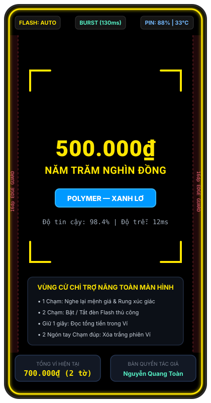
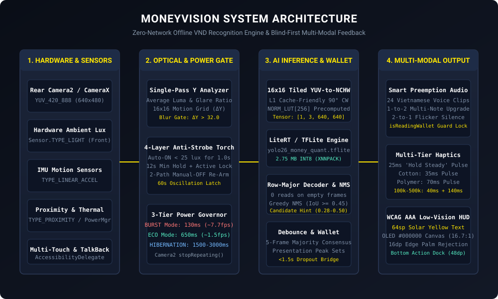
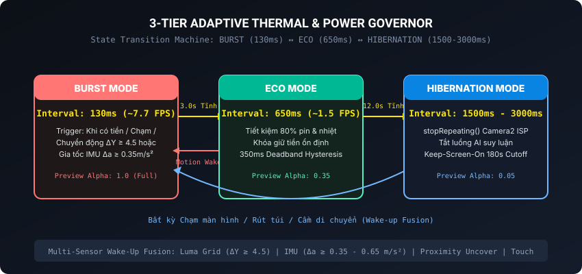

# MoneyVision — Ứng Dụng AI Trợ Năng Nhận Diện Tiền Việt Nam Đồng 100% Offline Cho Người Khiếm Thị

**Ngôn ngữ / Language:** **Tiếng Việt (Hiện tại)** | [English (README.en.md)](README.en.md)

- **Tác giả & Chủ sở hữu độc lập:** Nguyễn Quang Toàn (`Nguyễn Quang Toàn - Chủ sở hữu & Phát triển độc lập`)
- **Bản quyền:** `© 2026 Nguyễn Quang Toàn - Sở hữu & Phát triển độc lập` (All Rights Reserved)
- **Định danh gói ứng dụng (Application ID):** `com.nckh.moneyvision` | **Phiên bản:** `1.0.0` (`versionCode = 1`)
- **Nền tảng hỗ trợ:** Android 9.0 Pie (`minSdkVersion = 28`) đến Android 14+ (`targetSdkVersion = 34`)
- **Kiến trúc CPU:** Universal Dual-ABI (`armeabi-v7a` 32-bit và `arm64-v8a` 64-bit)
- **Chính sách an ninh:** 100% Offline (`Zero-Network`, không khai báo quyền `android.permission.INTERNET`)

---

## 1. Giới Thiệu Tổng Quan

**MoneyVision** là ứng dụng di động trợ năng thời gian thực được thiết kế chuyên biệt cho **người khiếm thị hoàn toàn (Blind)**, **người có thị lực kém (Low-Vision)** và **người cao tuổi** tại Việt Nam. Hệ thống kết hợp luồng hình ảnh từ Camera sau với mô hình thị giác máy tính lượng tử hóa **YOLO26n INT8 (`yolo26_money_quant.tflite`, 2.75 MB)** chạy trên **Google LiteRT / TensorFlow Lite JNI (XNNPACK)** để nhận diện chính xác toàn bộ **9 mệnh giá tiền giấy và tiền Polymer Việt Nam Đồng** đang lưu hành:

`1.000đ`, `2.000đ`, `5.000đ`, `10.000đ`, `20.000đ`, `50.000đ`, `100.000đ`, `200.000đ`, `500.000đ`.

Khác với các ứng dụng quét hình ảnh thương mại thông thường, MoneyVision được thiết kế từ gốc theo phương pháp kỹ thuật **Blind-First & Thermal-Safe Engineering**:

1. **Kiến Trúc 100% Offline & An Toàn Tuyệt Đối (Zero-Network Security)**:
   - Ứng dụng không yêu cầu quyền `android.permission.INTERNET` hay bất kỳ kết nối mạng nào. Mọi tác vụ tiền xử lý, suy luận mạng nơ-ron và tổng hợp âm thanh đều diễn ra cục bộ trên thiết bị với độ trễ thấp và bảo mật dữ liệu tuyệt đối.

2. **Giao Diện Trợ Năng Đạt Chuẩn WCAG AAA & Tương Thích Google TalkBack**:
   - Nền đen tuyệt đối **True OLED Black (`#000000`)** kết hợp chữ **Solar Yellow (`#FFE600`, độ tương phản 16.74:1)** kích thước cực đại **64sp**, khung ngắm định tâm 4 góc chữ L và huy hiệu màu đặc trưng cho từng loại tiền Polymer và Cotton.
   - Giải phóng **100% diện tích màn hình thành bề mặt cử chỉ xúc giác** kết hợp thuật toán **Lọc tì lòng bàn tay 16dp theo từng ngón (Per-Pointer Edge Palm-Rejection)**.
   - Vận hành mượt mà ở cả hai chế độ: khi tắt TalkBack (nhận diện cử chỉ đa điểm trực tiếp) và khi bật TalkBack (`Explore-by-Touch`) thông qua `View.AccessibilityDelegate`, `View.OnHoverListener`, `AccessibilityManager.interrupt()` và cơ chế ngắt tạm thời `AUDIOFOCUS_GAIN_TRANSIENT_MAY_DUCK` (Zero Talk-Over).

3. **Dẫn Đường Không Gian Xúc Giác & Bảng Mã Rung Phân Biệt 9 Mệnh Giá**:
   - Phát xung rung dẫn đường nhẹ **25ms** (*"Giữ yên tay"*) ngay khi phát hiện bóng tờ tiền lọt vào khung ngắm ($0.28 \le \text{score} < 0.50$).
   - Mã hóa xúc giác riêng biệt cho 9 mệnh giá theo 3 phân tầng (Tiền cotton = xung ngắn 35ms; Tiền polymer chục nghìn = xung vừa 70ms; Tiền polymer trăm nghìn = nhịp dẫn 40ms kết hợp xung dài 120ms–140ms), cho phép nhận biết mệnh giá ở môi trường ồn ào.

4. **Đèn Flash Thông Minh 4 Lớp Chống Chớp Tắt & Tự Động Khôi Phục Hai Nhánh**:
   - Kết hợp cảm biến ánh sáng phần cứng mặt trước (`Sensor.TYPE_LIGHT`), phân tích mốc nền phản xạ sau bật đèn (`postTorchBaselineLuma`) và tỷ lệ điểm chói cận cảnh (`glareRatio`), khóa giữ đèn tối thiểu 12 giây, khóa khi đang có tiền (`ACTIVE_DETECTION_LOCK`) và cầu chì chống dao động 60 giây (`Oscillation Latch`).
   - Khi người dùng chạm đúp tắt đèn thủ công, hệ thống tự động tái kích hoạt Auto-Torch theo 2 nhánh: khi ra khu vực sáng trong nhà ($\ge 35\text{ lux}$ sau 250ms) hoặc sau khoảng đệm 2.5 giây khi di chuyển sang vùng tối khác (nhờ chốt trạng thái `hasMovedSinceManualOff` từ lưới $\Delta Y \ge 4.5$ và gia tốc IMU $\Delta a \ge 0.35\text{ m/s}^2$).

5. **Bộ Đối Soát Ví Theo Đỉnh Lượt Cầm & Bảo Vệ Âm Thanh Đa Tờ**:
   - Đối soát đỉnh tập hợp mệnh giá trong từng lượt cầm ($W_{\text{total}} = W_{\text{baseline}} \oplus M_{\text{presentation}}$), nối tiếp mượt mà khi mất khung hình ngắn dưới 1.5 giây lúc chỉnh tay và tự động hiệu chỉnh mệnh giá cùng tổng số tờ $\ge 2$.
   - Tự động ngắt nâng cấp đa tờ (**Multi-Note Upgrade Preemption**) khi số tờ tăng từ 1 lên 2 tờ, giữ im lặng khi tụt số tờ tạm thời ($2 \rightarrow 1 \rightarrow 2$ tờ) và sử dụng khóa bảo vệ **`isReadingWallet`** ngăn camera cắt ngang câu đọc tổng kết Ví khi người dùng hạ tay xuống.

6. **Bộ Điều Tốc Năng Lượng & Nhiệt Độ 3 Tầng**:
   - Tự động chuyển đổi chu kỳ suy luận: **BURST (130ms)** $\rightarrow$ **ECO (650ms)** $\rightarrow$ **HIBERNATION (1500ms–3000ms)** kết hợp dừng luồng Camera2 (`captureSession.stopRepeating()`), cổng chặn nhòe chuyển động (`MOTION_BLUR_GATE`, $\Delta Y > 32.0$), xoay ảnh $16\times 16$ Cache-Tiled NCHW và giải mã thưa Row-Major (0 lượt đọc tọa độ khi khung hình trống).

---

## 2. Hình Ảnh & Sơ Đồ Thiết Kế Trực Quan

### 2.1. Cấu Trúc Màn Hình Trợ Năng Low-Vision HUD

Hình ảnh dưới đây mô tả cấu trúc giao diện chuẩn WCAG AAA trên màn hình thiết bị Android:



```text
+-------------------------------------------------------------+
| [FLASH: TỰ ĐỘNG]             [BURST (130ms)]   [PIN: 88% | 33°C] | <-- Thanh trạng thái phần cứng
+-------------------------------------------------------------+
|                                                             |
|   |--                                                   --| |
|   |                                                       | | <-- Khung ngắm chữ L (Viewfinder Reticle)
|                                                             |     Định tâm vị trí tờ tiền
|                                                             |
|                    500.000 ĐỒNG                             | <-- Hero Typography (64sp, Solar Yellow #FFE600)
|                                                             |     Tương phản 16.74:1 trên OLED Black #000000
|                                                             |
|                 [ POLYMER - XANH LƠ ]                       | <-- Huy hiệu màu mệnh giá (Nhận diện thị lực kém)
|                                                             |
|   |                                                       | |
|   |--                                                   --| |
|                                                             |
+-------------------------------------------------------------+
| <====== VÙNG AN TOÀN LỌC TÌ LÒNG BÀN TAY (16dp MỖI BÊN) =====> | <-- Per-Pointer Edge Palm-Rejection
|                                                             |
|              BỀ MẶT CỬ CHỈ TRỢ NĂNG TOÀN MÀN HÌNH:          |
|   - 1 Chạm: Nghe lại mệnh giá & Rung phản hồi              |
|   - 2 Chạm: Bật / Tắt đèn Flash thủ công                    |
|   - Giữ 1 giây: Đọc tổng tiền trong Ví                     |
|   - 2 Ngón tay Chạm đúp: Xóa sạch phiên Ví tích lũy         |
|                                                             |
+-------------------------------------------------------------+
| [ TỔNG VÍ: 700.000đ ]               [ TÁC GIẢ: QUANG TOÀN ] | <-- Bottom Action Dock (Nút bấm chuẩn 48dp)
+-------------------------------------------------------------+
```

### 2.2. Sơ Đồ Kiến Trúc Hệ Thống Tổng Thể



### 2.3. Máy Trạng Thái Bộ Điều Tốc Năng Lượng & Nhiệt Độ (BURST / ECO / HIBERNATION)



---

## 3. Bản Đồ Tài Liệu Kỹ Thuật

Dự án cung cấp bộ tài liệu kỹ thuật chuyên sâu bằng cả Tiếng Việt và Tiếng Anh:

| Tài liệu | Nội dung kỹ thuật | Đối tượng quan tâm |
| :--- | :--- | :--- |
| [`docs/BLIND_FIRST_UI_UX_SPECIFICATION.md`](docs/BLIND_FIRST_UI_UX_SPECIFICATION.md)<br>[`docs/BLIND_FIRST_UI_UX_SPECIFICATION.en.md`](docs/BLIND_FIRST_UI_UX_SPECIFICATION.en.md) | Đặc tả chi tiết giao diện Low-Vision HUD, công thái học lọc tì lòng bàn tay 16dp, máy trạng thái cử chỉ đa điểm, kiến trúc tương thích Google TalkBack và mã hóa xúc giác 9 mệnh giá. | UI/UX Engineers, Accessibility Specialists |
| [`docs/SYSTEM_ARCHITECTURE_AND_DESIGN.md`](docs/SYSTEM_ARCHITECTURE_AND_DESIGN.md)<br>[`docs/SYSTEM_ARCHITECTURE_AND_DESIGN.en.md`](docs/SYSTEM_ARCHITECTURE_AND_DESIGN.en.md) | Phân tích sâu kiến trúc Dual-Runtime (TypeScript & Native Android), tiền xử lý $16\times 16$ Cache-Tiled YUV-to-NCHW, giải mã thưa Row-Major, bộ điều tốc năng lượng 3 tầng và đóng gói APK Universal. | Systems / Android Native Engineers, AI Engineers |
| [`README.md`](README.md)<br>[`README.en.md`](README.en.md) | Cổng tài liệu tổng quan song ngữ, hướng dẫn cài đặt, chạy bộ kiểm thử tự động và đóng gói bản phát hành. | Toàn bộ lập trình viên |

---

## 4. Cấu Trúc Thư Mục Mã Nguồn

```text
App_android/
├── App.tsx                                 # Root Component tích hợp CameraViewport, GestureCanvas, TactileDisplay
├── package.json                            # Cấu hình dự án & Metadata bản quyền tác giả Nguyễn Quang Toàn
├── LICENSE                                 # Giấy phép phần mềm MIT
├── .gitignore                              # Cấu hình loại trừ tệp nhạy cảm và binary phát hành
├── README.md                               # Tài liệu kỹ thuật chính (Tiếng Việt)
├── README.en.md                            # Tài liệu kỹ thuật chính (English)
├── docs/
│   ├── images/                             # Sơ đồ vector và đồ họa kiến trúc hiển thị trên GitHub
│   │   ├── system_architecture.svg         # Sơ đồ luồng dữ liệu kiến trúc hệ thống
│   │   ├── viewfinder_reticle_hud.svg      # Bản vẽ giao diện trợ năng Low-Vision HUD
│   │   └── power_governor_state.svg        # Máy trạng thái bộ điều tốc nhiệt/pin 3 tầng
│   ├── BLIND_FIRST_UI_UX_SPECIFICATION.md  # Đặc tả UI/UX trợ năng (Tiếng Việt)
│   ├── BLIND_FIRST_UI_UX_SPECIFICATION.en.md # Đặc tả UI/UX trợ năng (English)
│   ├── SYSTEM_ARCHITECTURE_AND_DESIGN.md   # Phân tích kỹ thuật hệ thống (Tiếng Việt)
│   └── SYSTEM_ARCHITECTURE_AND_DESIGN.en.md # Phân tích kỹ thuật hệ thống (English)
├── packages/
│   └── antigravity-skills-pack/            # Gói độc lập 51 kỹ năng Antigravity (kèm install.ps1 & install.sh)
├── src/                                    # TẦNG TYPESCRIPT / REACT NATIVE
│   ├── constants/                          # Hằng số bản quyền tác giả và bảng màu WCAG AAA
│   ├── types/                              # Định nghĩa kiểu dữ liệu TypeScript
│   ├── utils/                              # Nhận diện cử chỉ đa điểm, lọc tì bàn tay 16dp, định dạng tiền tệ
│   ├── hooks/                              # useMoneyState: Điều phối Camera, Debounce, Governor, Audio, Haptics
│   ├── components/                         # CameraViewport, EdgePulseBorder, GestureCanvas, TactileDisplay
│   └── services/                           # Bộ phân tích kênh Y, Đèn flash thông minh, Bộ điều tốc, Giải mã YOLO
├── android/                                # TẦNG NATIVE ANDROID
│   ├── build.gradle                        # Cấu hình minSdkVersion = 28 (Android 9.0), targetSdkVersion = 34
│   ├── libs/litert-1.0.1.aar               # Thư viện Google LiteRT C++ runtime cục bộ
│   └── app/
│       ├── build.gradle                    # Cấu hình Dual-ABI (armeabi-v7a, arm64-v8a) và chữ ký số v1+v2+v3
│       ├── release.keystore                # Khóa ký số RSA 4096-bit phục vụ tái lập build offline
│       ├── proguard-rules.pro              # Quy tắc bảo vệ JNI cho LiteRT, CameraX và Native Modules
│       └── src/main/
│           ├── AndroidManifest.xml         # Zero-Network Manifest (CAMERA, VIBRATE, FLASHLIGHT; 0 INTERNET)
│           ├── assets/models/              # yolo26_money_quant.tflite (Mô hình INT8 2.75 MB)
│           ├── res/raw/                    # 24 file âm thanh tiếng Việt chuẩn (.mp3) và âm hiệu (.wav)
│           └── java/com/nckh/moneyvision/  # MainActivity, MoneyAudioModule, MoneyCameraView, Yolo26Detector
├── scripts/                                # BỘ KIỂM THỬ VÀ ĐÓNG GÓI ĐỘC LẬP
│   ├── test-runner.mjs                     # Bộ chạy 222 bài kiểm thử tự động trên 21 Suites
│   ├── verify-apk-package.mjs              # Script kiểm định 10 tiêu chí an ninh và bản quyền APK
│   ├── build-release-apk.mjs               # Script biên dịch và đóng gói Universal Release APK
│   └── android-sdk-builder.mjs             # Trình biên dịch Android SDK trực tiếp (javac, d8, aapt2, apksigner)
└── release/
    └── com.nckh.moneyvision-v1.0.0-universal-release.apk  # Gói cài đặt Universal APK chính thức (9.10 MB)
```

---

## 5. Hướng Dẫn Kiểm Thử & Đóng Gói Ứng Dụng

Hệ thống kiểm thử và đóng gói được xây dựng bằng **Node.js Built-in Test Runner** không cần phụ thuộc thư viện bên ngoài.

### 5.1. Chạy Toàn Bộ 21 Bộ Kiểm Thử Tự Động (222/222 Tests)

Kiểm tra toàn diện từ định dạng tiền tệ, độ tương phản WCAG AAA, máy trạng thái cử chỉ và lọc tì lòng bàn tay 16dp, hàng đợi âm thanh ngắt nâng cấp đa tờ, đèn Flash 4 lớp chống chớp tắt, bộ điều tốc nhiệt/pin 3 tầng, giải mã thưa tensor YOLO26n INT8, bộ lọc 5-frame consensus và bộ đối soát Ví đến kiểm tra cấu trúc mã máy bytecode `classes.dex`:

```bash
node scripts/test-runner.mjs
```

Kết quả mong đợi: `222 tests, 0 failures (100% Pass)`.

### 5.2. Chạy Kiểm Định 10 Tiêu Chí An Ninh, Tương Thích & Bản Quyền APK

Xác thực kiến trúc Zero-Network (`INTERNET = 0`), khóa ký số RSA 4096-bit, Dual-ABI (`armeabi-v7a` + `arm64-v8a`), `minSdkVersion = 28` / `targetSdkVersion = 34`, chữ ký số `v1 + v2 + v3`, 24 tệp âm thanh thực tế, model `yolo26_money_quant.tflite` (`TFL3`) và thông tin bản quyền Nguyễn Quang Toàn:

```bash
node scripts/verify-apk-package.mjs
```

### 5.3. Biên Dịch & Đóng Gói Bản Phát Hành Universal APK

Biên dịch lại toàn bộ mã nguồn Native, tài nguyên âm thanh, mô hình `.tflite`, căn chỉnh bộ nhớ `zipalign` (4096-byte cho thư viện `.so` và 4-byte cho tài nguyên) và ký số bằng `android/app/release.keystore`:

```bash
node scripts/build-release-apk.mjs
```

Tệp APK đầu ra được lưu tại:
- `release/com.nckh.moneyvision-v1.0.0-universal-release.apk` (Dung lượng: 9.10 MB — hỗ trợ cài đặt trên mọi thiết bị Android từ phiên bản 9.0 Pie đến 14+).

---

## 6. Giấy Phép & Bản Quyền

Dự án được phân phối dưới [Giấy phép MIT](LICENSE).

- Bản quyền: `© 2026 Nguyễn Quang Toàn - Sở hữu & Phát triển độc lập`
- Tác giả & Chủ sở hữu độc lập: **Nguyễn Quang Toàn**
