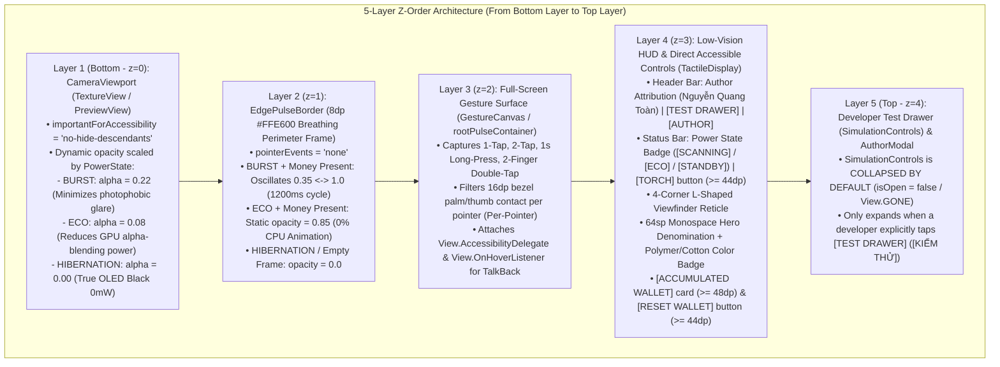
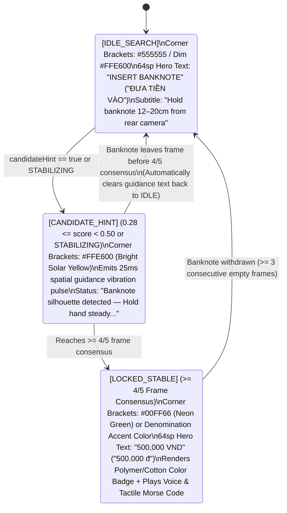
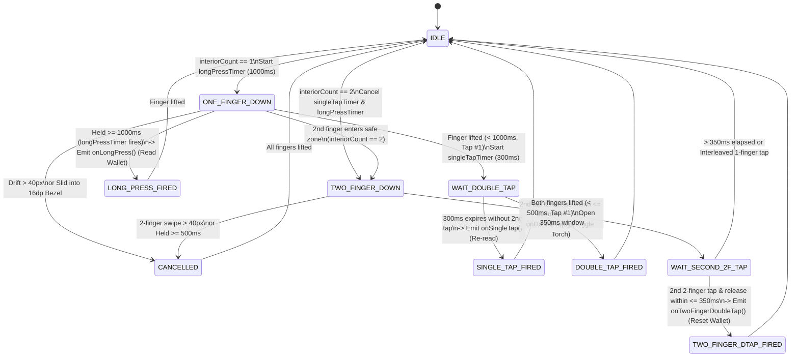
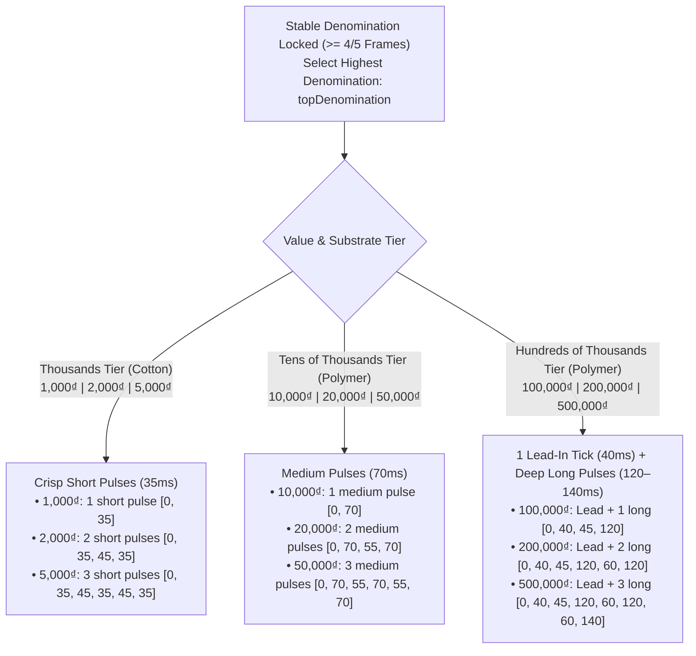

# Blind-First UI/UX & TalkBack Accessibility Specification

> **Language / Ngôn ngữ:** [Tiếng Việt](BLIND_FIRST_UI_UX_SPECIFICATION.md) | **English (Current)**
>
> **Project:** **MoneyVision** (`com.nckh.moneyvision`)  
> **Author & Independent Owner:** **Nguyễn Quang Toàn** (`© 2026 Nguyễn Quang Toàn - Sở hữu & Phát triển độc lập`)  
> **Document Scope:** Architectural specification of the WCAG AAA+ Low-Vision HUD, Two-Handed Physical Ergonomics (`Per-Pointer 16dp Edge Palm-Rejection`), Full-Screen Multi-Touch Gesture State Machine, Dual-Mode Google TalkBack Compatibility (`Explore-by-Touch` & `Zero Talk-Over`), Multi-Tier Tactile Vocabulary (`25ms` Spatial Guidance + 9-Denomination Tactile Coding), and Multi-Note / Wallet Readout Lock / Smart Torch Recovery UX.

---

## 1. Dual-Audience Accessibility Philosophy

According to the World Health Organization (WHO) and the W3C Low Vision Accessibility Task Force (LVTF), visually impaired smartphone users fall into **two distinct behavioral cohorts**:
1. **Totally Blind Users (~15–20%)**:
   - Rely zero percent on visual rendering; interact 100% through **Google TalkBack (`Explore-by-Touch`)**, **eyes-free multi-touch gestures**, **auditory earcons**, **Vietnamese voice clips**, and **haptic vibration patterns**.
   - Primary failure modes in conventional apps: Small on-screen buttons accidentally triggered while gripping the phone, custom touch gestures swallowed by TalkBack's `TouchExploration` interceptor, or TalkBack's synthetic voice talking over the app's currency announcements.
2. **Low-Vision / Residual Vision Users (~80–85%)**:
   - Retain the ability to perceive ultra-high-contrast light/dark regions, framing reticles, and high-saturation color blocks at close range (10–25 cm), but suffer severe glare and photophobia on white backgrounds.
   - Consequently, the UI requires a **True OLED Black (`#000000`)** background paired with **`64sp` Solar Yellow (`#FFE600`)** hero typography and **high-saturation Polymer/Cotton color badges matching the State Bank of Vietnam's banknote palette**.

### 1.1. 5-Layer Display & Touch Z-Order Architecture

The interface hierarchy is synchronized 1:1 between the React Native layer ([`App.tsx`](file:///c:/Users/ADMIN/NCKH/App_android/App.tsx), [`GestureCanvas.tsx`](file:///c:/Users/ADMIN/NCKH/App_android/src/components/GestureCanvas.tsx), [`TactileDisplay.tsx`](file:///c:/Users/ADMIN/NCKH/App_android/src/components/TactileDisplay.tsx), [`EdgePulseBorder.tsx`](file:///c:/Users/ADMIN/NCKH/App_android/src/components/EdgePulseBorder.tsx)) and the Native Android layer (`buildAccessibleInterface()` in [`scripts/android-sdk-builder.mjs`](file:///c:/Users/ADMIN/NCKH/App_android/scripts/android-sdk-builder.mjs)) across 5 stacked Z-layers:

---

## 2. Low-Vision HUD Visual Anatomy (WCAG AAA+)

All color constants, typography tokens, and denomination visual specs are centrally defined in [`src/constants/theme.ts`](file:///c:/Users/ADMIN/NCKH/App_android/src/constants/theme.ts) and automatically verified via [`calculateContrastRatio`](file:///c:/Users/ADMIN/NCKH/App_android/src/utils/formatters.ts) to exceed **WCAG 2.1 Level AAA ($\ge 7.0:1$)**.

### 2.1. WCAG AAA Color Palette & Contrast Ratios

| UI Token | Hex Code | Reference Background | Contrast Ratio | Ergonomic & Visual Purpose |
| :--- | :---: | :---: | :---: | :--- |
| **Primary Background (`background`)** | `#000000` | — | — | Switches off OLED subpixels completely (0 mW) and eliminates intraocular scatter/glare. |
| **Primary Text & Border (`primaryYellow`)** | `#FFE600` | `#000000` | **`16.74 : 1`** (AAA) | ~575nm wavelength maximally stimulates both L and M cones in low-vision retinas. |
| **Secondary Text & Labels (`secondaryWhite`)** | `#FFFFFF` | `#000000` | **`21.00 : 1`** (AAA) | Maximum theoretical contrast for copyright attribution and guidance subtitles. |
| **Torch Active / Locked (`statusTorchOn`)** | `#00FF66` | `#000000` | **`15.86 : 1`** (AAA) | Signals active LED flashlight or a locked 4/5-frame banknote consensus. |
| **Alert / Reset Wallet (`alertRed`)** | `#FF3B30` | `#000000` | **`5.89 : 1`** (AA Large) | Borders the `[RESET WALLET]` (`[XÓA VÍ]`) button so low-vision users distinguish reset from wallet readout. |

### 2.2. 4-Corner L-Shaped Viewfinder Reticle (`testID="viewfinder-reticle"`)

In [`TactileDisplay.tsx`](file:///c:/Users/ADMIN/NCKH/App_android/src/components/TactileDisplay.tsx) and `MainActivity.java` ([`scripts/android-sdk-builder.mjs`](file:///c:/Users/ADMIN/NCKH/App_android/scripts/android-sdk-builder.mjs)), the central scanning region is framed by 4 high-contrast L-shaped corner brackets (`4dp`–`5dp` stroke width) that transition across 3 recognition phases:

### 2.3. 9-Denomination Visual & Material Identification Specs (`DENOMINATION_VISUAL_SPECS`)

Defined in [`src/constants/theme.ts`](file:///c:/Users/ADMIN/NCKH/App_android/src/constants/theme.ts) ([`getDenominationVisualSpec`](file:///c:/Users/ADMIN/NCKH/App_android/src/constants/theme.ts)), each recognized Vietnamese banknote displays a **Material & Color Identification Badge (`testID="polymer-color-badge"`)** with a high-saturation background and bold black typography (`#000000`, maintaining a black-on-badge contrast ratio $\ge 5.0:1$ across all 9 notes):

| Denomination (`classId`) | Substrate (`material`) | State Bank of Vietnam Characteristic Hue | Hex (`colorHex`) | HUD Badge Label (`badgeLabel`) |
| :---: | :---: | :--- | :---: | :--- |
| **`500,000 ₫`** | `POLYMER` | Bright Cyan-Teal | `#00E5FF` | `POLYMER • 500K CYAN TEAL` (`XANH LỤC LAM`) |
| **`200,000 ₫`** | `POLYMER` | Warm Amber-Red | `#FF6D00` | `POLYMER • 200K ORANGE RED` (`ĐỎ CAM`) |
| **`100,000 ₫`** | `POLYMER` | Bright Emerald Green | `#00E676` | `POLYMER • 100K GREEN` (`XANH LÁ`) |
| **`50,000 ₫`** | `POLYMER` | Vibrant Magenta-Pink | `#FF4081` | `POLYMER • 50K MAGENTA PINK` (`HỒNG TÍM`) |
| **`20,000 ₫`** | `POLYMER` | Deep Sky Blue | `#40C4FF` | `POLYMER • 20K SKY BLUE` (`XANH DƯƠNG`) |
| **`10,000 ₫`** | `POLYMER` | Warm Gold-Yellow | `#FFD740` | `POLYMER • 10K GOLD YELLOW` (`VÀNG NÂU`) |
| **`5,000 ₫`** | `COTTON` | Light Teal-Blue | `#80D8FF` | `COTTON • 5K TEAL BLUE` (`XANH CỔ VỊT`) |
| **`2,000 ₫`** | `COTTON` | Silver-Grey | `#E0E0E0` | `COTTON • 2K GREY` (`XÁM TRẮNG`) |
| **`1,000 ₫`** | `COTTON` | Pale Cream-Gold | `#FFF59D` | `COTTON • 1K LIGHT YELLOW` (`VÀNG NHẠT`) |

### 2.4. Power State Badge (`testID="power-state-badge"`)

Gives low-vision users and sighted companions immediate visibility into the 3-Tier Adaptive Power Governor ([`formatPowerStateBadge`](file:///c:/Users/ADMIN/NCKH/App_android/src/constants/theme.ts)):
- **`[SCANNING]`** (`[ĐANG QUÉT]`, `#00FF66` — `BURST 130ms` active scanning): Hand/scene motion or active banknote verification.
- **`[ECO]`** (`#FFE600` — `ECO 650ms` power saving): Banknote already announced and held steady, or static scene $> 2.5\text{s}$.
- **`[STANDBY]`** (`[CHỜ]`, `#9E9E9E` — `HIBERNATION 1500ms/3000ms` deep standby): Phone resting on a table or inside a pocket $> 8\text{s}$.

---

## 3. Two-Handed Physical Ergonomics & Per-Pointer `16dp` Edge Palm-Rejection

### 3.1. Physical Grip Mechanics When a Blind User Counts Cash

When a blind user counts banknotes in the real world:
- The **left hand** holds or fans the banknotes 12–20 cm in front of the rear camera lens.
- The **right hand** grips the phone body. When gripping a smartphone one-handed, the **thenar eminence (base of the thumb) or fingertips inevitably wrap around the screen bezel (`0–16dp` edge perimeter)**.

Without dedicated ergonomic filtering, two critical failures occur:
1. **Accidental Simulation Button Triggers**: If a 15-button debug panel (`1K`..`500K`) sits exposed at the bottom of the screen, the user's palm presses fake denominations during real cash transactions.
   - **Solution**: `SimulationControls` is collapsed by default (`isSimulationDrawerOpen = false` in [`App.tsx`](file:///c:/Users/ADMIN/NCKH/App_android/App.tsx) and `controlsPanel.setVisibility(View.GONE)` in `MainActivity.java`). It only opens when a developer taps the compact **`[TEST DRAWER]`** (`[KIỂM THỬ]`, `testID="toggle-simulation-drawer-btn"`) header button.
2. **Multi-Touch Gesture Corruption from Bezel Grip**: When the gripping thumb rests on the screen edge (Pointer #0 at $x = 6\text{px}$) while the index finger taps the center of the screen to re-read a banknote (Pointer #1 at $x = 200\text{px}$), Android reports `pointerCount = 2`. A naive gesture detector misinterprets this as a 2-finger gesture or cancels the single tap!

### 3.2. Per-Pointer Safe-Zone Filtering Algorithm

Implemented identically in [`src/utils/gestureRecognizer.ts`](file:///c:/Users/ADMIN/NCKH/App_android/src/utils/gestureRecognizer.ts) ([`isPointInsideSafeZone`](file:///c:/Users/ADMIN/NCKH/App_android/src/utils/gestureRecognizer.ts), [`filterInteriorTouchPoints`](file:///c:/Users/ADMIN/NCKH/App_android/src/utils/gestureRecognizer.ts)) and `setupGestureCanvas()` in [`scripts/android-sdk-builder.mjs`](file:///c:/Users/ADMIN/NCKH/App_android/scripts/android-sdk-builder.mjs):

```mermaid
flowchart LR
    Raw["Multi-Touch MotionEvent / PanResponder\n(touches = [P1, P2, ...])"] --> Filter["Per-Pointer 16dp Safe-Zone Filter\nisPointInsideSafeZone(x, y, W, H, 16dp)\nCondition: 16dp <= x <= W-16dp\nand 16dp <= y <= H-16dp"]
    Filter -->|"interiorCount == 0\n(All pointers are within 16dp bezel)"| EdgeCheck{"Is an interior touch\nsession currently active?"}
    EdgeCheck -->|"No"| Ignore["Ignore Completely\nDo not start a touch session"]
    EdgeCheck -->|"Yes (Finger slid from\ninterior into 16dp bezel)"| Cancel["Cancel Current Session\n(sessionCancelled = true)\nClear Long-Press Timer"]
    Filter -->|"interiorCount >= 1\n(Retain only interior pointers)"| ActiveCheck{"Did a 2nd palm pointer touch\nthe bezel during a 1s Long Press?"}
    ActiveCheck -->|"interiorCount still == 1"| KeepTimer["Preserve 1s Long-Press Timer!\n(Never reset timer due to bezel palm contact)"]
    ActiveCheck -->|"Standard Gesture Processing"| StateMachine["Feed interiorTouches into\nGestureRecognizer State Machine"]
```

**Technical Invariants Verified in Suite 17 ([`scripts/test-runner.mjs`](file:///c:/Users/ADMIN/NCKH/App_android/scripts/test-runner.mjs)):**
1. Any touch or hold inside the $< 16\text{dp}$ border (`x < 16` or `x > W - 16` or `y < 16` or `y > H - 16`) is completely ignored.
2. When 1 thumb rests on the `16dp` edge and 1 finger taps the center $\rightarrow$ `interiorTouches.length === 1` $\rightarrow$ accurately recognized as a **Single Tap** or **Double Tap**.
3. When 1 thumb rests on the `16dp` edge and 2 fingers double-tap the center (3 physical pointers total) $\rightarrow$ `interiorTouches.length === 2` $\rightarrow$ accurately recognized as a **Two-Finger Double Tap** to reset the wallet.
4. When 1 finger is holding a Long Press in the center (`700ms` into the `1000ms` threshold) and the user's palm brushes the `16dp` edge $\rightarrow$ `longPressTimer` **is not restarted**, firing the Wallet Summary readout right on schedule at `1000ms`.
5. If 1 finger starts in the center and slides out into the `16dp` edge before release $\rightarrow$ the session is marked `sessionCancelled = true`, preventing a false `Single Tap`.

---

## 4. Full-Screen Multi-Touch Gesture State Machine (`GestureRecognizer`)

The [`GestureRecognizer`](file:///c:/Users/ADMIN/NCKH/App_android/src/utils/gestureRecognizer.ts) class manages 4 eyes-free gestures using ergonomic temporal and spatial thresholds:

| Gesture (`GestureAction`) | Physical Action | Technical Thresholds | System Action & Multi-Modal Feedback |
| :--- | :--- | :--- | :--- |
| **`SINGLE_TAP`** | 1-finger tap & release | Hold $< 1000\text{ms}$, drift $\le 40\text{px}$, no 2nd tap within $300\text{ms}$. | **Re-read current detection** (bypasses the $1.5\text{s}$ cooldown). If empty, speaks *"Không có tiền trong tầm quét"* (*"No banknote in scanning range"*). |
| **`DOUBLE_TAP`** | 1-finger rapid double tap | Inter-tap interval $\le 300\text{ms}$ (`doubleTapThresholdMs`). | **Manual Flashlight Toggle** (`isManualOverride = true`), plays `torch_on.wav` / `torch_off.wav` + double haptic pulse `[0, 40, 60, 40]`. When manually turned OFF, Auto-Torch automatically re-arms via **2 smart recovery paths** (entering $\ge 35\text{ lux}$ indoor light or relocating in darkness after $\ge 2.5\text{s}$). |
| **`LONG_PRESS`** | 1-finger steady hold | Continuous hold $\ge 1000\text{ms}$ (`longPressThresholdMs`), drift $\le 40\text{px}$. | **Read Accumulated Session Wallet** (`SessionWalletState`) + `200ms` deep haptic vibration. Engages **`isReadingWallet = true`** protection lock so lowering the hand (`EMPTY` frame) never cuts off wallet speech. |
| **`TWO_FINGER_DOUBLE_TAP`** | 2-finger rapid double tap | Two 2-finger taps within $\le 350\text{ms}$ (`twoFingerDoubleTapThresholdMs`), each hold $< 500\text{ms}$, drift $\le 40\text{px}$. | **Reset Session Wallet to `0 ₫`**, plays `wallet_reset.wav` + warning haptic cadence `[0, 60, 50, 60, 50, 120]`. |

---

## 5. Dual-Mode Google TalkBack Architecture (`Explore-by-Touch`) & `Zero Talk-Over`

### 5.1. Why Standard Gesture Apps Break When Google TalkBack Is Enabled

When a blind user enables **Google TalkBack (`TouchExploration`)** on Android:
1. A physical **1-finger single tap** is intercepted by the OS and converted into **`MotionEvent.ACTION_HOVER_ENTER` / `ACTION_HOVER_MOVE` / `ACTION_HOVER_EXIT`** exploration events (`ACTION_DOWN` is never delivered to `OnTouchListener`!).
2. A physical **1-finger double tap** is consumed by TalkBack and dispatched as **`performAccessibilityAction(ACTION_CLICK)`** (or a single synthesized click) on the focused accessibility node.
3. Physical **2-finger gestures** are intercepted by TalkBack as system gestures (pausing TalkBack speech or scrolling containers).
4. If any `TextView` updates rapidly (such as live LUX telemetry or scanning status) with `accessibilityLiveRegion="polite"`, TalkBack continuously reads those status strings aloud, **talking directly over the app's Vietnamese currency announcements**.

### 5.2. Dual-Mode TalkBack Bridge Solution

In [`GestureCanvas.tsx`](file:///c:/Users/ADMIN/NCKH/App_android/src/components/GestureCanvas.tsx), [`TactileDisplay.tsx`](file:///c:/Users/ADMIN/NCKH/App_android/src/components/TactileDisplay.tsx), and `MainActivity.java` ([`scripts/android-sdk-builder.mjs`](file:///c:/Users/ADMIN/NCKH/App_android/scripts/android-sdk-builder.mjs)), **MoneyVision** resolves all four conflicts simultaneously:

```mermaid
sequenceDiagram
    autonumber
    actor User as Blind User (Google TalkBack ON)
    participant TB as Android TalkBack OS\n(TouchExploration)
    participant Canvas as rootPulseContainer / GestureCanvas\n(AccessibilityDelegate + OnHoverListener)
    participant Buttons as Direct Accessible Buttons (>= 44dp)\n([TORCH] | [WALLET] | [RESET])
    participant Audio as MoneyAudioModule\n(MP3/WAV + AudioFocus + Interrupt)

    rect rgb(25, 35, 50)
    Note over User,Audio: Scenario A: Standard TalkBack 1-Finger Double-Tap on Canvas to Re-Read Denomination
    User->>TB: 1-Finger Double-Tap (TalkBack Activate)
    TB->>Canvas: performAccessibilityAction(ACTION_CLICK)
    Canvas->>Audio: onSingleTapGesture() -> Re-reads current banknote denomination
    end

    rect rgb(30, 45, 35)
    Note over User,Audio: Scenario B: 1-Second Explore-by-Touch Hover Hold or Double-Tap-and-Hold
    User->>TB: Places 1 finger to explore center screen (> 16dp from bezel)
    TB->>Canvas: onHover(ACTION_HOVER_ENTER / ACTION_HOVER_MOVE)
    Canvas->>Canvas: Starts hoverLongPressRunnable (1000ms, drift tolerance <= 35dp)
    Canvas-->>Audio: After 1000ms steady hold -> onLongPressGesture() (Reads Session Wallet + 200ms Haptic)
    end

    rect rgb(45, 30, 45)
    Note over User,Audio: Scenario C: Swiping to Direct >= 44dp Buttons or Opening TalkBack Actions Menu
    User->>TB: Swipes right to focus "[TORCH]" / "[WALLET]" / "[RESET]" & double-taps
    TB->>Buttons: OnClickListener / AccessibilityAction (0x1001..0x1004)
    Buttons->>Audio: Toggles Torch OR Reads Session Wallet OR Resets Wallet to 0₫
    end

    rect rgb(50, 35, 20)
    Note over User,Audio: Scenario D: Zero Talk-Over Enforcement During Vietnamese Voice Playback
    Audio->>TB: a11yManager.interrupt() (Immediately silences verbose TalkBack speech)
    Audio->>TB: requestAudioFocus(AUDIOFOCUS_GAIN_TRANSIENT_MAY_DUCK)
    Audio->>User: Plays crystal-clear Vietnamese MP3 sequence ("Hai tờ", "Năm trăm nghìn")
    Audio->>TB: Holds AudioFocus across inter-word gaps -> abandonAudioFocusNow() 400ms after completion
    end
```

#### Core Engineering Components of the TalkBack Bridge:
1. **Complete Suppression of Automatic Live Regions (`accessibilityLiveRegion="none"`)**:
   - Every dynamic text node (`hero-denomination-text`, `detection-summary-text`, `announcement-status-text`) in [`TactileDisplay.tsx`](file:///c:/Users/ADMIN/NCKH/App_android/src/components/TactileDisplay.tsx) sets `accessibilityLiveRegion="none"`, preventing TalkBack from spontaneously interrupting camera scans.
2. **Separation of Background Gesture Surface (`talkback-gesture-surface`) and Direct Action Buttons ($\ge 44\text{dp}$)**:
   - In [`GestureCanvas.tsx`](file:///c:/Users/ADMIN/NCKH/App_android/src/components/GestureCanvas.tsx), the focusable gesture surface sits as an absolute background layer (`StyleSheet.absoluteFill`), allowing TalkBack users either to activate the main canvas to re-read notes or swipe directly to large action targets:
     - **`[TORCH]`** (`[ĐÈN PIN]`, `testID="torch-toggle-btn"`, `minHeight: 44dp`, `minWidth: 76dp`)
     - **`[ACCUMULATED WALLET]`** (`[VÍ TÍCH LŨY]`, `testID="wallet-card-btn"`, `minHeight: 48dp`)
     - **`[RESET WALLET]`** (`[XÓA VÍ]`, `testID="wallet-reset-btn"`, `minHeight: 44dp`, `minWidth: 92dp`)
     - **`[AUTHOR]`** (`[TÁC GIẢ]`, `testID="open-author-modal-btn"`) & **`[TEST DRAWER]`** (`[KIỂM THỬ]`, `testID="toggle-simulation-drawer-btn"`)
3. **4 Custom Accessibility Actions in the TalkBack Local Context Menu (`Custom AccessibilityActions`)**:
   - Registered on `AccessibilityNodeInfo` across both Native Android (`A11Y_ACTION_REREAD = 0x1001`, `A11Y_ACTION_TOGGLE_TORCH = 0x1002`, `A11Y_ACTION_READ_WALLET = 0x1003`, `A11Y_ACTION_RESET_WALLET = 0x1004`) and React Native (`accessibilityActions`):
     1. *"Re-read current banknote denomination"* (*"Đọc lại mệnh giá tiền hiện tại"*)
     2. *"Toggle flashlight for banknote scanning"* (*"Bật hoặc tắt đèn pin hỗ trợ quét tiền"*)
     3. *"Read accumulated session wallet total"* (*"Đọc tổng số tiền trong ví tích lũy"*)
     4. *"Reset accumulated wallet to 0 VND"* (*"Xóa ví tích lũy về 0 đồng"*)
4. **`AccessibilityManager.interrupt()` & Continuous Multi-Clip `AudioFocus` Holding**:
   - In [`MoneyAudioModule.kt`](file:///c:/Users/ADMIN/NCKH/App_android/android/app/src/main/java/com/nckh/moneyvision/audio/MoneyAudioModule.kt) and `MoneyAudioModule.java` ([`scripts/android-sdk-builder.mjs`](file:///c:/Users/ADMIN/NCKH/App_android/scripts/android-sdk-builder.mjs)), when playing a multi-word phrase (e.g., `tick.wav` $\rightarrow$ `qty_2.mp3` $\rightarrow$ `vnd_500k.mp3`), any pending `abandonFocusRunnable` from the previous clip is cancelled as soon as the next clip starts, guaranteeing TalkBack cannot inject speech into the `40ms` inter-word gap, and releasing `AudioFocus` `400ms` after the final word completes (or immediately on `stop()` / `destroy()`).

---

## 6. Spatial Guidance Pulse (`25ms`) & 9-Denomination Tactile Coding (`Tactile Morse Code`)

### 6.1. `"Hold Hand Steady"` Spatial Guidance Pulse (`25ms` Candidate Guidance Pulse)

When a blind user brings a banknote toward the rear camera, the note often enters at an angle or near the frame border before reaching crisp focus for a $\ge 4/5$ frame lock.
- As soon as the YOLO26 decoder detects an **early candidate silhouette (`0.28 <= score < 0.50` $\rightarrow$ `hasCandidateHint = true`)** or the 5-frame filter enters **`STABILIZING`** (before locking a stable denomination):
  - The system emits a **subtle `25ms` tactile guidance pulse** ([`CANDIDATE_GUIDANCE_PULSE_MS = 25`](file:///c:/Users/ADMIN/NCKH/App_android/src/services/haptics.ts)) rate-limited by a **`1200ms` cooldown** (`CANDIDATE_GUIDANCE_COOLDOWN_MS = 1200`).
  - The HUD simultaneously displays: **`"Banknote silhouette detected — Hold hand steady..."`** (*"Phát hiện bóng tờ tiền — Giữ yên tay..."*).
  - If the note leaves the frame before reaching 4/5 consensus (`!hasCandidateHint && debounced.state === 'EMPTY'`), `hadCandidateHintRef` / `wasCandidateGuidanceActive` automatically resets the HUD and reticle back to the idle state so guidance text never gets stuck on screen.

### 6.2. 9-Denomination Tactile Vibration Coding Table (`getDenominationVibrationPattern`)

In noisy environments (traditional markets, bus stations, busy streets), blind users may struggle to hear the phone speaker. [`getDenominationVibrationPattern`](file:///c:/Users/ADMIN/NCKH/App_android/src/services/haptics.ts) in [`src/services/haptics.ts`](file:///c:/Users/ADMIN/NCKH/App_android/src/services/haptics.ts) and `MainActivity.java` encodes **each of the 9 Vietnamese banknote denominations into a unique Tactile Morse Code signature** organized across 3 substrate/value tiers:

| Denomination | Value & Substrate Tier | `Vibration.vibrate(pattern)` Timing Array (`[wait, vibrate, pause, vibrate...]`) | Tactile Sensation in the Blind User's Hand |
| :---: | :--- | :--- | :--- |
| **`1,000 ₫`** | Thousands (Cotton) | `[0, 35]` | `Tick` (1 short `35ms` pulse) |
| **`2,000 ₫`** | Thousands (Cotton) | `[0, 35, 45, 35]` | `Tick - Tick` (2 short `35ms` pulses) |
| **`5,000 ₫`** | Thousands (Cotton) | `[0, 35, 45, 35, 45, 35]` | `Tick - Tick - Tick` (3 short `35ms` pulses) |
| **`10,000 ₫`** | Tens of Thousands (Polymer) | `[0, 70]` | `Buzz` (1 medium `70ms` pulse) |
| **`20,000 ₫`** | Tens of Thousands (Polymer) | `[0, 70, 55, 70]` | `Buzz - Buzz` (2 medium `70ms` pulses) |
| **`50,000 ₫`** | Tens of Thousands (Polymer) | `[0, 70, 55, 70, 55, 70]` | `Buzz - Buzz - Buzz` (3 medium `70ms` pulses) |
| **`100,000 ₫`** | Hundreds of Thousands (Polymer) | `[0, 40, 45, 120]` | `Tick - LONG PULSE` (`40ms` lead + 1 `120ms` pulse) |
| **`200,000 ₫`** | Hundreds of Thousands (Polymer) | `[0, 40, 45, 120, 60, 120]` | `Tick - LONG - LONG` (`40ms` lead + 2 `120ms` pulses) |
| **`500,000 ₫`** | Hundreds of Thousands (Polymer) | `[0, 40, 45, 120, 60, 120, 60, 140]` | `Tick - LONG - LONG - DEEP LONG` (`40ms` lead + 3 long pulses) |

> [!TIP]
> **Consistency Across Back-to-Back Banknote Swaps:** In [`SmartPreemptionController.ts`](file:///c:/Users/ADMIN/NCKH/App_android/src/services/audio/SmartPreemptionController.ts), whenever the stable banknote state transitions to a new denomination (whether from an empty frame or directly swapping a `100,000₫` note for a `500,000₫` note), `hapticNotifier.triggerMoneyDetected(topDenom)` emits the exact vibration pattern of the newly detected denomination. Conversely, when the user performs a `Single Tap` (`handleSingleTap`) to re-read the same banknote, the system plays the voice announcement without repeating the long vibration sequence to prevent hand fatigue.

---

## 7. Multi-Note Scanning UX, Wallet Readout Protection & Smart Torch Recovery

In everyday transactions, blind users frequently hold **2 to 3 banknotes fanned in one hand** to verify change quickly, lower their hand as soon as they long-press to listen to the accumulated wallet total, or double-tap to turn off the flashlight before walking into another dark area. Three core UX mechanisms ensure audio, wallet math, and lighting behave naturally and deterministically:

```mermaid
sequenceDiagram
    autonumber
    actor User as Blind User
    participant Cam as Camera & TemporalDebounce
    participant Wallet as PresentationWalletAccumulator
    participant Audio as SmartPreemptionController
    participant Torch as SmartTorchController

    rect rgb(25, 42, 35)
    Note over User,Audio: Scenario 1: Holding Two 100,000₫ Notes (Sequential 1 -> 2 Convergence & 2 -> 1 -> 2 Hand Jitter)
    User->>Cam: Holds two 100k notes in view (Note #1 converges first at t = 0.5s)
    Cam->>Wallet: onStableDetection([{100k: 1}])
    Wallet-->>Wallet: M_presentation = {100k: 1} -> Wallet Total = 100,000₫ (1 note)
    Cam->>Audio: handleDetectionUpdate([{100k: 1}])
    Audio-->>User: Starts speaking: "Một trăm..." ("One hundred...", currentlyAnnouncingNotesCount = 1)
    User->>Cam: Note #2 enters crisp focus (t = 0.8s, while 1-note speech is still mid-sentence)
    Cam->>Wallet: onStableDetection([{100k: 2}])
    Wallet-->>Wallet: Max-reconciles M_presentation = {100k: 2} -> Wallet Total = 200,000₫ (2 notes, NEVER 300k!)
    Cam->>Audio: handleDetectionUpdate([{100k: 2}]) (newTotalNotes 2 > 1)
    Audio-->>User: Immediately preempts 1-note speech -> Speaks: "Hai tờ một trăm nghìn" ("Two notes one hundred thousand")
    User->>Cam: Slight hand tremor briefly occludes 1 note ({100k: 2} -> {100k: 1} -> {100k: 2})
    Cam->>Wallet: onStableDetection([{100k: 1}]) then [{100k: 2}]
    Wallet-->>Wallet: Preserves peak M_presentation = {100k: 2} (Wallet Total remains 200,000₫)
    Cam->>Audio: Downward-Flicker Suppression
    Audio-->>User: Remains completely silent (neither announces drop to 1 note nor repeats 2 notes)
    end

    rect rgb(30, 35, 55)
    Note over User,Audio: Scenario 2: 1-Second Long Press to Read Wallet & Lowering Hand Holding Cash (isReadingWallet Lock)
    User->>Audio: Long-Presses 1s (or taps "[ACCUMULATED WALLET]" card)
    Audio->>Audio: Sets isReadingWallet = true + Vibrates 200ms
    Audio-->>User: Begins reading wallet total: "Hai tờ một trăm nghìn..." ("Two notes one hundred thousand...")
    User->>Cam: Lowers hand holding banknotes to listen -> Camera transitions to EMPTY
    Cam->>Wallet: Commits presentation (>= 1.2s EMPTY -> W_baseline = 200,000₫)
    Cam->>Audio: handleDetectionUpdate([]) (EMPTY)
    Audio->>Audio: Checks isReadingWallet == true -> BLOCKS stop() & BLOCKS empty.wav!
    Audio-->>User: Completes full Wallet Summary announcement uninterrupted -> Resets isReadingWallet = false
    end

    rect rgb(50, 32, 28)
    Note over User,Torch: Scenario 3: Double-Tap Manual Torch OFF & Walking Into a New Dark Area (2-Path Smart Recovery)
    User->>Torch: Double-taps to turn OFF flashlight in a dark room (18 lux)
    Torch-->>User: Turns torch OFF (isManualOverride = true) + Plays torch_off.wav
    Note over User,Torch: While holding phone still at same spot (18 lux, ΔY < 4.5, Δa < 0.35): Torch stays OFF
    User->>Torch: Walks to another dark corner (t = 1.0s: ΔY >= 4.5 / IMU >= 0.35 -> Latches hasMovedSinceManualOff = true)
    User->>Torch: Stops to scan cash in the dark (t = 2.6s >= 2500ms grace, 12 lux < 25 lux)
    Torch->>Torch: Clears isManualOverride = false & Starts 1000ms low-light confirmation timer
    Torch-->>User: After 1.0s -> Automatically turns Torch ON + Plays torch_on.wav + Vibrates 100ms
    end
```

### 7.1. Three Core UX Laws for Multi-Note & Torch Interaction

1. **Never Let a Blind User Hear Two Confusing Sequential Utterances for the Same Handful of Cash (`Multi-Note Upgrade Preemption & Downward-Flicker Silence`)**:
   - When holding two `100,000₫` notes where the first note focuses `300ms` earlier than the second, letting the app finish saying *"Một trăm nghìn"* and then saying *"Hai tờ một trăm nghìn"* causes a blind user (who cannot see the screen) to believe the app counted `1` note plus `2` more notes (`300,000₫`).
   - Therefore, whenever the total note count in the current presentation **increases** (`newTotalNotes > currentlyAnnouncingNotesCount`), the controller immediately preempts the partial `1-note` utterance and speaks the upgraded total (*"Hai tờ một trăm nghìn"*), while the wallet accumulator updates its presentation peak from `1` to `2` notes (`200,000₫`).
   - Conversely, when slight hand movement temporarily hides one of the two notes (`2 -> 1 -> 2`), the controller **remains completely silent** and preserves `presentationPeakAnnouncedSig`, eliminating disorienting downward/upward audio chatter.

2. **Absolute Protection of Wallet Summary Speech When Lowering the Hand (`isReadingWallet` Protection Lock)**:
   - A blind user's natural physical reflex after triggering a 1-second `Long Press` to hear their accumulated wallet total is to **lower the hand holding the banknotes** while listening.
   - Protected by `isReadingWallet`, the resulting camera `EMPTY` transition silently commits the wallet baseline in the background **without calling `stop()` and without playing `empty.wav`**. If the user actively wishes to interrupt the wallet readout, any intentional new touch gesture (`Single Tap`, `Double Tap`, or `Two-Finger Double Tap`) preempts it immediately.

3. **Respect Stationary Manual Torch-OFF While Automatically Re-Arming Upon Relocation (`2-Path Smart Manual-OFF Recovery`)**:
   - When the user double-taps to turn off the flashlight, the torch remains off as long as they stay stationary at that spot.
   - As soon as they pass through a lit/dim indoor hallway ($\ge 35\text{ lux}$ after `250ms`) **or** walk/reposition into another dark area (latching `hasMovedSinceManualOff = true` via IMU acceleration $\Delta a \ge 0.35\text{ m/s}^2$ or optical motion $\Delta Y \ge 4.5$, or entering deeper darkness $\ge 6\text{ lux}$ darker after a `2.5-second` grace window), Auto-Torch seamlessly re-arms and illuminates after `1 second` of sustained darkness.
