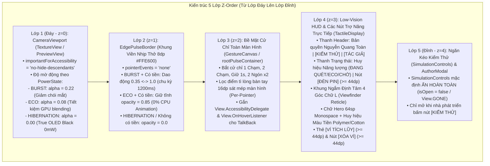
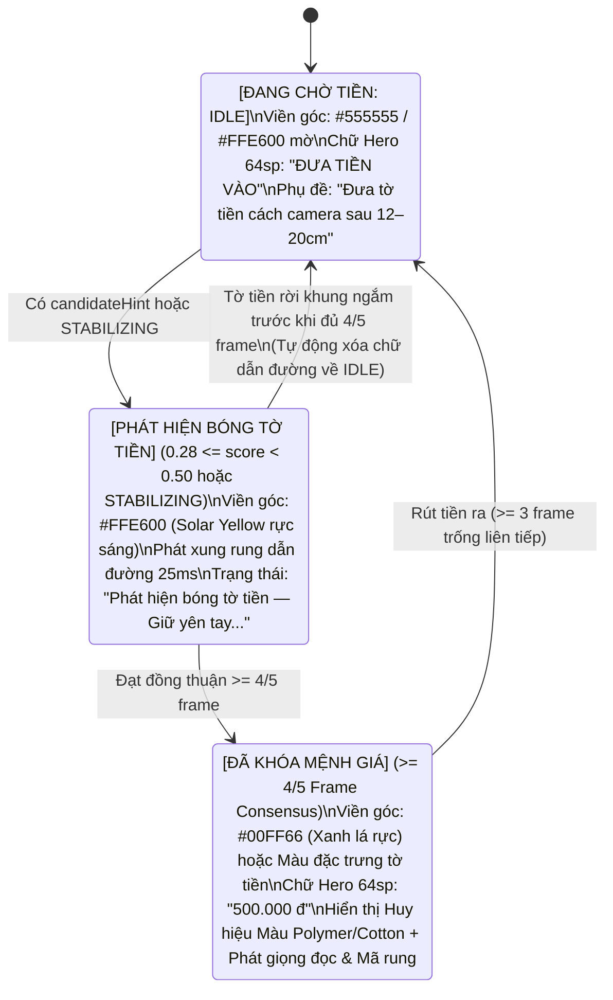
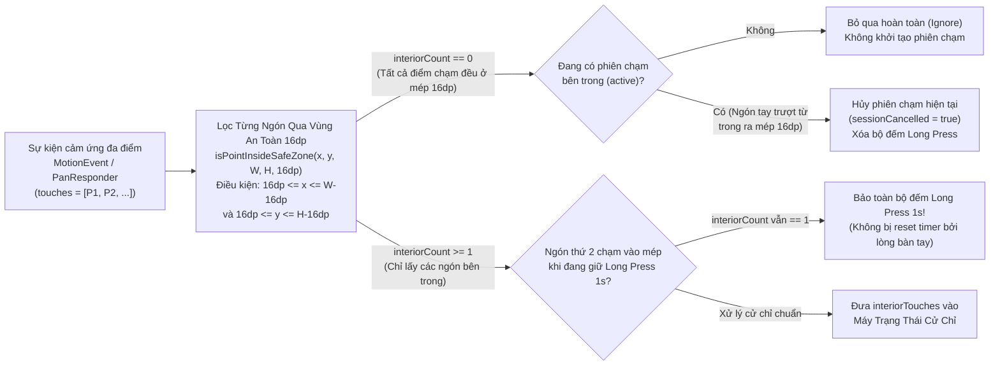
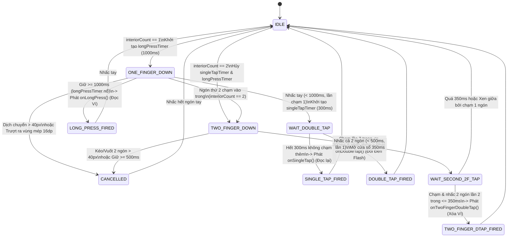
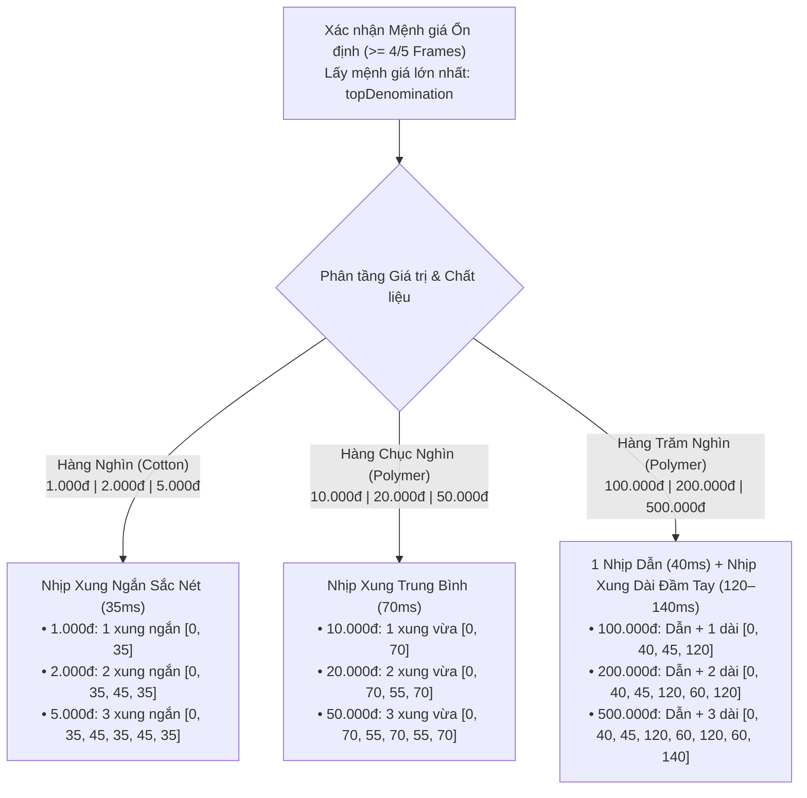

# Đặc Tả Thiết Kế Giao Diện & Trải Nghiệm Trợ Năng (Blind-First UI/UX & TalkBack Specification)

> **Ngôn ngữ / Language:** **Tiếng Việt (Hiện tại)** | [English (`BLIND_FIRST_UI_UX_SPECIFICATION.en.md`)](BLIND_FIRST_UI_UX_SPECIFICATION.en.md)
>
> **Dự án:** **MoneyVision** (`com.nckh.moneyvision`)  
> **Tác giả & Chủ sở hữu độc lập:** **Nguyễn Quang Toàn** (`© 2026 Nguyễn Quang Toàn - Sở hữu & Phát triển độc lập`)  
> **Phạm vi tài liệu:** Phân tích kiến trúc Giao diện Thị giác Tương phản Cực đại (WCAG AAA+ Low-Vision HUD), Công thái học Cầm máy 2 Tay (`Per-Pointer 16dp Edge Palm-Rejection`), Máy trạng thái Cử chỉ Đa điểm Toàn màn hình, Kiến trúc Tương thích Hai Chế độ với Google TalkBack (`Explore-by-Touch` & `Zero Talk-Over`), và Ngôn ngữ Xúc giác Đa tầng (`25ms` Spatial Guidance + Bảng Mã Rung 9 Mệnh Giá).

---

## 1. Triết Lý Thiết Kế Phục Vụ Kép (Dual-Audience Accessibility Philosophy)

Theo thống kê của Tổ chức Y tế Thế giới (WHO) và W3C Low Vision Accessibility Task Force (LVTF), cộng đồng người khiếm thị sử dụng điện thoại thông minh chia thành **2 nhóm hành vi rõ rệt**:
1. **Người khiếm thị hoàn toàn (Totally Blind — ~15–20%)**:
   - Không dựa vào màn hình; tương tác 100% qua **trình đọc màn hình Google TalkBack (`Explore-by-Touch`)**, **cử chỉ chạm mù (eyes-free gestures)**, **âm hiệu (earcons)**, **giọng đọc tiếng Việt** và **xung rung xúc giác (haptics)**.
   - Rủi ro lớn nhất trên các ứng dụng thông thường: Các nút bấm nhỏ trên màn hình bị chạm nhầm khi cầm máy, hoặc cử chỉ riêng của app bị TalkBack nuốt mất, hoặc giọng đọc của TalkBack đọc đè (talk-over) lên giọng đọc mệnh giá tiền.
2. **Người có thị lực kém / Thị lực phần dư (Low-Vision / Residual Vision — ~80–85%)**:
   - Vẫn phân biệt được mảng sáng/tối tương phản cực cao, khung định tâm và màu sắc độ bão hòa lớn ở cự ly gần (10–25 cm), nhưng bị chói lóa (photophobia) trên nền trắng.
   - Do đó, giao diện cần nền **True OLED Black (`#000000`)** kết hợp chữ **Solar Yellow (`#FFE600`)** cỡ đại **`64sp`** và **Huy hiệu màu đặc trưng của từng mệnh giá tiền Polymer/Cotton Việt Nam**.

### 1.1. Sơ Đồ Phân Tầng Hiển Thị & Cảm Ứng (`Z-Order Layering Architecture`)

Hệ thống giao diện được đồng bộ hóa giữa tầng React Native ([`App.tsx`](file:///c:/Users/ADMIN/NCKH/App_android/App.tsx), [`GestureCanvas.tsx`](file:///c:/Users/ADMIN/NCKH/App_android/src/components/GestureCanvas.tsx), [`TactileDisplay.tsx`](file:///c:/Users/ADMIN/NCKH/App_android/src/components/TactileDisplay.tsx), [`EdgePulseBorder.tsx`](file:///c:/Users/ADMIN/NCKH/App_android/src/components/EdgePulseBorder.tsx)) và tầng Native Android (`buildAccessibleInterface()` trong [`scripts/android-sdk-builder.mjs`](file:///c:/Users/ADMIN/NCKH/App_android/scripts/android-sdk-builder.mjs)) theo cấu trúc 5 lớp xếp chồng:

---

## 2. Giải Phẫu Giao Diện Low-Vision HUD (WCAG AAA+ Visual Anatomy)

Toàn bộ hằng số màu sắc, cỡ chữ và bảng màu mệnh giá được định nghĩa tập trung tại [`src/constants/theme.ts`](file:///c:/Users/ADMIN/NCKH/App_android/src/constants/theme.ts) và kiểm chứng tự động qua hàm [`calculateContrastRatio`](file:///c:/Users/ADMIN/NCKH/App_android/src/utils/formatters.ts) đạt vượt chuẩn **WCAG 2.1 Level AAA ($\ge 7.0:1$)**.

### 2.1. Hệ Thống Bảng Màu & Tỷ Lệ Tương Phản Chuẩn WCAG AAA

| Thành phần giao diện | Mã màu Hex | Nền đối chiếu | Tỷ lệ tương phản | Mục đích công thái học |
| :--- | :---: | :---: | :---: | :--- |
| **Nền chính (`background`)** | `#000000` | — | — | Tắt hoàn toàn điểm ảnh OLED (0 mW), triệt tiêu hiện tượng lóa mắt (glare). |
| **Chữ chính & Viền (`primaryYellow`)** | `#FFE600` | `#000000` | **`16.74 : 1`** (AAA) | Bước sóng ~575nm kích thích đồng thời tế bào nón L và M mạnh nhất cho mắt nhìn mờ. |
| **Chữ phụ & Nhãn (`secondaryWhite`)** | `#FFFFFF` | `#000000` | **`21.00 : 1`** (AAA) | Độ tương phản lý thuyết tối đa cho thông tin bản quyền và hướng dẫn. |
| **Đèn Flash Bật (`statusTorchOn`)** | `#00FF66` | `#000000` | **`15.86 : 1`** (AAA) | Báo hiệu trạng thái Đèn Flash đang bật hoặc Khung ngắm đã khóa mệnh giá tiền. |
| **Cảnh báo / Xóa ví (`alertRed`)** | `#FF3B30` | `#000000` | **`5.89 : 1`** (AA Large) | Viền nút `[XÓA VÍ]` giúp người thị lực kém phân biệt vùng xóa với vùng đọc ví. |

### 2.2. Khung Ngắm Định Tâm 4 Góc Chữ L (`Viewfinder Reticle` — `testID="viewfinder-reticle"`)

Trong [`TactileDisplay.tsx`](file:///c:/Users/ADMIN/NCKH/App_android/src/components/TactileDisplay.tsx) và `MainActivity.java` ([`scripts/android-sdk-builder.mjs`](file:///c:/Users/ADMIN/NCKH/App_android/scripts/android-sdk-builder.mjs)), vùng trung tâm màn hình được bao bởi khung ngắm 4 góc chữ L có độ dày viền `4dp`–`5dp`, tự động đổi màu theo 3 pha nhận diện:

### 2.3. Bảng Màu Nhận Diện Nhanh 9 Mệnh Giá Tiền Việt Nam (`DENOMINATION_VISUAL_SPECS`)

Được định nghĩa tại [`src/constants/theme.ts`](file:///c:/Users/ADMIN/NCKH/App_android/src/constants/theme.ts) (hàm [`getDenominationVisualSpec`](file:///c:/Users/ADMIN/NCKH/App_android/src/constants/theme.ts)), mỗi mệnh giá tiền Việt Nam khi được nhận diện sẽ hiển thị một **Huy hiệu Màu sắc & Chất liệu (`testID="polymer-color-badge"`)** có nền màu bão hòa cao và chữ đen đậm (`#000000`, tỷ lệ tương phản chữ đen trên nền huy hiệu luôn $\ge 5.0:1$):

| Mệnh giá (`classId`) | Chất liệu (`material`) | Màu đặc trưng Ngân hàng Nhà nước | Mã Hex (`colorHex`) | Nhãn Huy hiệu (`badgeLabel`) |
| :---: | :--- | :--- | :---: | :--- |
| **`500.000 đ`** | `POLYMER` | Xanh lục lam sáng (Cyan-Teal) | `#00E5FF` | `POLYMER • 500K XANH LỤC LAM` |
| **`200.000 đ`** | `POLYMER` | Đỏ cam sáng (Warm Amber-Red) | `#FF6D00` | `POLYMER • 200K ĐỎ CAM` |
| **`100.000 đ`** | `POLYMER` | Xanh lá cây sáng (Bright Green) | `#00E676` | `POLYMER • 100K XANH LÁ` |
| **`50.000 đ`** | `POLYMER` | Hồng tím sáng (Magenta-Pink) | `#FF4081` | `POLYMER • 50K HỒNG TÍM` |
| **`20.000 đ`** | `POLYMER` | Xanh dương sáng (Deep Sky Blue) | `#40C4FF` | `POLYMER • 20K XANH DƯƠNG` |
| **`10.000 đ`** | `POLYMER` | Vàng hổ phách (Gold-Yellow) | `#FFD740` | `POLYMER • 10K VÀNG NÂU` |
| **`5.000 đ`** | `COTTON` | Xanh lơ sáng (Light Teal-Blue) | `#80D8FF` | `COTTON • 5K XANH CỔ VỊT` |
| **`2.000 đ`** | `COTTON` | Xám bạc sáng (Silver-Grey) | `#E0E0E0` | `COTTON • 2K XÁM TRẮNG` |
| **`1.000 đ`** | `COTTON` | Vàng kem sáng (Pale Cream-Gold) | `#FFF59D` | `COTTON • 1K VÀNG NHẠT` |

### 2.4. Huy Hiệu Trạng Thái Năng Lượng (`Power State Badge` — `testID="power-state-badge"`)

Giúp người thị lực kém và người hỗ trợ nhận biết tức thì trạng thái hoạt động của Bộ điều tốc năng lượng 3 tầng ([`formatPowerStateBadge`](file:///c:/Users/ADMIN/NCKH/App_android/src/constants/theme.ts)):
- **`[ĐANG QUÉT]`** (`#00FF66` — Chế độ `BURST 130ms`): Khi có chuyển động tay hoặc đang xác thực tờ tiền.
- **`[ECO]`** (`#FFE600` — Chế độ `ECO 650ms`): Khi đã đọc xong tờ tiền và tay đang giữ yên hoặc cảnh tĩnh $> 2.5\text{s}$.
- **`[CHỜ]`** (`#9E9E9E` — Chế độ `HIBERNATION 1500ms/3000ms`): Khi đặt máy trên bàn hoặc bỏ túi không dùng $> 8\text{s}$.

---

## 3. Công Thái Học Cầm Máy 2 Tay & Lọc Tì Lòng Bàn Tay (`Per-Pointer 16dp Edge Palm-Rejection`)

### 3.1. Bài Toán Thực Tế Khi Người Khiếm Thị Đếm Tiền

Khi người khiếm thị đếm tiền ngoài đời thực:
- **Tay trái** cầm xấp tiền đưa ra phía trước ống kính camera sau (cách 12–20 cm).
- **Tay phải** nắm giữ thân điện thoại. Khi nắm chặt máy bằng một tay, **phần thịt lòng bàn tay (thenar eminence) hoặc đầu ngón tay cái/ngón út luôn tì vào sát mép màn hình cảm ứng (vùng viền 0–16dp)**.

Nếu không xử lý công thái học này, sẽ xảy ra **2 lỗi nghiêm trọng**:
1. **Chạm nhầm nút giả lập**: Nếu bảng 15 nút giả lập (`1K`..`500K`) hiện ở đáy màn hình, lòng bàn tay sẽ chạm trúng làm máy đọc tiền giả.
   - **Giải pháp**: Thu gọn mặc định `SimulationControls` (`isSimulationDrawerOpen = false` trong [`App.tsx`](file:///c:/Users/ADMIN/NCKH/App_android/App.tsx) và `controlsPanel.setVisibility(View.GONE)` trong `MainActivity.java`). Chỉ khi bấm nút nhỏ **`[KIỂM THỬ]`** (`testID="toggle-simulation-drawer-btn"`) trên thanh Header thì ngăn kéo mới mở ra.
2. **Nhiễm cử chỉ đa điểm do ngón tay nắm viền máy**: Khi ngón cái tì vào mép màn hình (Pointer #0 tại $x = 6\text{px}$) trong lúc ngón trỏ tay kia chạm vào giữa màn hình để nghe lại (Pointer #1 tại $x = 200\text{px}$), hệ điều hành báo `pointerCount = 2`. Một bộ nhận diện cử chỉ thông thường sẽ tưởng nhầm đây là thao tác 2 ngón hoặc hủy bỏ cú chạm đơn!

### 3.2. Thuật Toán Lọc Điểm Chạm Theo Từng Ngón (`Per-Pointer Safe Zone Filtering`)

Được triển khai đồng bộ tại [`src/utils/gestureRecognizer.ts`](file:///c:/Users/ADMIN/NCKH/App_android/src/utils/gestureRecognizer.ts) ([`isPointInsideSafeZone`](file:///c:/Users/ADMIN/NCKH/App_android/src/utils/gestureRecognizer.ts), [`filterInteriorTouchPoints`](file:///c:/Users/ADMIN/NCKH/App_android/src/utils/gestureRecognizer.ts)) và `setupGestureCanvas()` trong [`scripts/android-sdk-builder.mjs`](file:///c:/Users/ADMIN/NCKH/App_android/scripts/android-sdk-builder.mjs):

**Các bất biến kỹ thuật (Invariants) đã được kiểm thử trong Suite 17 ([`scripts/test-runner.mjs`](file:///c:/Users/ADMIN/NCKH/App_android/scripts/test-runner.mjs)):**
1. Chạm hoặc giữ ở vùng mép $< 16\text{dp}$ (`x < 16` hoặc `x > W - 16` hoặc `y < 16` hoặc `y > H - 16`) hoàn toàn bị bỏ qua.
2. Khi 1 ngón đang tì ở mép `16dp` và 1 ngón chạm vào vùng trung tâm $\rightarrow$ `interiorTouches.length === 1` $\rightarrow$ nhận diện chính xác là **1 Chạm (`Single Tap`)** hoặc **2 Chạm (`Double Tap`)**.
3. Khi 1 ngón đang tì ở mép `16dp` và 2 ngón chạm đúp vào vùng trung tâm (tổng cộng 3 pointers trên màn hình) $\rightarrow$ `interiorTouches.length === 2` $\rightarrow$ nhận diện chính xác là **2 Ngón Chạm Đúp (`Two-Finger Double Tap`)** xóa ví.
4. Khi 1 ngón đang nhấn giữ ở trung tâm (được `700ms` trên hành trình `1000ms` của `Long Press`) mà lòng bàn tay vô tình quệt vào mép `16dp` $\rightarrow$ bộ đếm `longPressTimer` **không bị khởi động lại từ đầu**, đúng `300ms` sau vẫn kích hoạt đọc Ví tích lũy.
5. Nếu 1 ngón bắt đầu chạm ở trung tâm nhưng trượt (swipe) ra vùng mép `16dp` trước khi nhấc tay $\rightarrow$ phiên chạm bị đánh dấu `sessionCancelled = true`, không phát sinh `Single Tap` giả.

---

## 4. Máy Trạng Thái Cử Chỉ Đa Điểm Toàn Màn Hình (`GestureRecognizer` State Machine)

Lớp [`GestureRecognizer`](file:///c:/Users/ADMIN/NCKH/App_android/src/utils/gestureRecognizer.ts) quản lý 4 cử chỉ mắt nhắm (eyes-free gestures) với các ngưỡng thời gian và khoảng cách chuẩn công thái học:

| Cử chỉ (`GestureAction`) | Thao tác vật lý | Thông số kỹ thuật | Hành động hệ thống & Phản hồi |
| :--- | :--- | :--- | :--- |
| **`SINGLE_TAP`** | Chạm 1 ngón rồi nhấc lên | Thời gian giữ $< 1000\text{ms}$, dịch chuyển $\le 40\text{px}$, không có lần chạm thứ 2 trong $300\text{ms}$. | **Đọc lại kết quả hiện tại** (bỏ qua khoảng lặng Cooldown $1.5\text{s}$). Nếu không có tiền, đọc *"Không có tiền trong tầm quét"*. |
| **`DOUBLE_TAP`** | Chạm đúp 1 ngón liên tiếp | Khoảng cách giữa 2 lần chạm $\le 300\text{ms}$ (`doubleTapThresholdMs`). | **Bật / Tắt Đèn Flash thủ công** (`isManualOverride = true`), phát âm hiệu `torch_on.wav` / `torch_off.wav` + rung đúp `[0, 40, 60, 40]`. Khi tắt đèn thủ công, hệ thống tự động tái kích hoạt Auto-Torch theo **2 nhánh thông minh** (khi ra chỗ sáng $\ge 35\text{ lux}$ hoặc sau $\ge 2.5\text{s}$ khi bước sang vùng tối khác / tối sâu hơn). |
| **`LONG_PRESS`** | Nhấn giữ 1 ngón tại chỗ | Giữ liên tục $\ge 1000\text{ms}$ (`longPressThresholdMs`), dịch chuyển $\le 40\text{px}$. | **Đọc tổng tiền Ví tích lũy trong phiên** (`SessionWalletState`) + rung dài đầm tay `200ms`. Bật khóa **`isReadingWallet = true`** bảo vệ câu đọc Ví không bị ngắt khi người dùng hạ tay cầm tiền xuống làm khung hình trống (`EMPTY`). |
| **`TWO_FINGER_DOUBLE_TAP`** | Chạm đúp bằng 2 ngón tay | 2 lần chạm 2 ngón cách nhau $\le 350\text{ms}$ (`twoFingerDoubleTapThresholdMs`), mỗi lần giữ $< 500\text{ms}$, kéo $\le 40\text{px}$. | **Đặt lại Ví tích lũy về `0 đ`**, phát âm hiệu `wallet_reset.wav` + chuỗi rung cảnh báo `[0, 60, 50, 60, 50, 120]`. |

---

## 5. Kiến Trúc Tương Thích Google TalkBack (`Explore-by-Touch`) & Chống Đọc Đè (`Zero Talk-Over`)

### 5.1. Tại Sao Các Ứng Dụng Cử Chỉ Thông Thường Bị Vô Hiệu Hóa Khi Bật TalkBack?

Khi người khiếm thị bật **Google TalkBack (`TouchExploration`)** trên Android:
1. Thao tác **1 chạm (`Single Tap`)** của người dùng bị hệ điều hành chặn và biến thành sự kiện dò tìm **`MotionEvent.ACTION_HOVER_ENTER` / `ACTION_HOVER_MOVE` / `ACTION_HOVER_EXIT`** (không hề gửi `ACTION_DOWN` tới `OnTouchListener`!).
2. Thao tác **2 chạm (`Double Tap`)** của người dùng bị TalkBack hấp thụ và chuyển thành **`performAccessibilityAction(ACTION_CLICK)`** (hoặc 1 cặp `ACTION_DOWN` + `ACTION_UP` đơn lẻ) trên phần tử đang có khung focus trợ năng.
3. Thao tác **2 ngón tay** bị TalkBack dùng làm cử chỉ hệ thống (tạm dừng giọng đọc TalkBack hoặc cuộn danh sách).
4. Nếu một `TextView` trên màn hình liên tục thay đổi văn bản (ví dụ cập nhật độ sáng LUX hoặc trạng thái quét) và bật `accessibilityLiveRegion="polite"`, TalkBack sẽ liên tục đọc to các dòng chữ đó, **đè hoàn toàn lên giọng đọc mệnh giá tiền tiếng Việt của ứng dụng**.

### 5.2. Giải Pháp Cầu Nối Trợ Năng Hai Chế Độ (`Dual-Mode TalkBack Bridge`)

Trong [`GestureCanvas.tsx`](file:///c:/Users/ADMIN/NCKH/App_android/src/components/GestureCanvas.tsx), [`TactileDisplay.tsx`](file:///c:/Users/ADMIN/NCKH/App_android/src/components/TactileDisplay.tsx) và `MainActivity.java` ([`scripts/android-sdk-builder.mjs`](file:///c:/Users/ADMIN/NCKH/App_android/scripts/android-sdk-builder.mjs)), **MoneyVision** giải quyết triệt để cả 4 vấn đề trên:

```mermaid
sequenceDiagram
    autonumber
    actor User as Người Khiếm Thị (Đang Bật TalkBack)
    participant TB as Hệ điều hành Android TalkBack\n(TouchExploration)
    participant Canvas as rootPulseContainer / GestureCanvas\n(AccessibilityDelegate + OnHoverListener)
    participant Buttons as Các Nút Trợ Năng Trực Tiếp (>= 44dp)\n([ĐÈN PIN] | [VÍ TÍCH LŨY] | [XÓA VÍ])
    participant Audio as MoneyAudioModule\n(MP3/WAV + AudioFocus + Interrupt)

    rect rgb(25, 35, 50)
    Note over User,Audio: Kịch bản A: Người dùng chạm đúp chuẩn TalkBack vào màn hình chính để nghe lại mệnh giá
    User->>TB: Chạm đúp 1 ngón (TalkBack Activate)
    TB->>Canvas: performAccessibilityAction(ACTION_CLICK)
    Canvas->>Audio: onSingleTapGesture() -> Đọc lại mệnh giá tiền hiện tại
    end

    rect rgb(30, 45, 35)
    Note over User,Audio: Kịch bản B: Người dùng dò chạm giữ 1 giây (Explore-by-Touch Hold) hoặc Double-Tap-and-Hold
    User->>TB: Đặt 1 ngón tay dò trên vùng giữa màn hình (> 16dp từ mép)
    TB->>Canvas: onHover(ACTION_HOVER_ENTER / ACTION_HOVER_MOVE)
    Canvas->>Canvas: Khởi tạo hoverLongPressRunnable (1000ms, sai số <= 35dp)
    Canvas-->>Audio: Sau 1000ms giữ yên -> onLongPressGesture() (Đọc tổng Ví tích lũy + Rung 200ms)
    end

    rect rgb(45, 30, 45)
    Note over User,Audio: Kịch bản C: Người dùng vuốt chọn các nút lớn >= 44dp hoặc mở Menu Hành động TalkBack
    User->>TB: Vuốt phải chọn nút "[ĐÈN PIN]" / "[VÍ TÍCH LŨY]" / "[XÓA VÍ]" rồi chạm đúp
    TB->>Buttons: OnClickListener / AccessibilityAction (0x1001..0x1004)
    Buttons->>Audio: Bật/Tắt đèn HOẶC Đọc tổng ví HOẶC Xóa ví về 0đ
    end

    rect rgb(50, 35, 20)
    Note over User,Audio: Kịch bản D: Cơ chế Zero Talk-Over khi phát chuỗi giọng đọc tiếng Việt
    Audio->>TB: a11yManager.interrupt() (Ngắt tức thì câu đọc rườm rà của TalkBack)
    Audio->>TB: requestAudioFocus(AUDIOFOCUS_GAIN_TRANSIENT_MAY_DUCK)
    Audio->>User: Phát chuỗi MP3 tiếng Việt rõ nét ("Hai tờ", "Năm trăm nghìn")
    Audio->>TB: Giữ AudioFocus xuyên suốt các từ -> abandonAudioFocusNow() sau 400ms khi kết thúc
    end
```

#### Các thành phần kỹ thuật cốt lõi của Cầu nối TalkBack:
1. **Tắt hoàn toàn Live Region tự động (`accessibilityLiveRegion="none"`)**:
   - Mọi vùng văn bản biến thiên (`hero-denomination-text`, `detection-summary-text`, `announcement-status-text`) trong [`TactileDisplay.tsx`](file:///c:/Users/ADMIN/NCKH/App_android/src/components/TactileDisplay.tsx) đều đặt `accessibilityLiveRegion="none"`, ngăn TalkBack tự ý đọc đè khi camera đang quét.
2. **Tách biệt Bề mặt Cử chỉ Nền (`talkback-gesture-surface`) và Các Nút Chạm Trực tiếp ($\ge 44\text{dp}$)**:
   - Trong [`GestureCanvas.tsx`](file:///c:/Users/ADMIN/NCKH/App_android/src/components/GestureCanvas.tsx), bề mặt nhận focus của vùng cử chỉ được đặt ở lớp nền tuyệt đối (`StyleSheet.absoluteFill`), giúp người dùng TalkBack vừa có thể chạm vào khoảng trống để nghe lại, vừa có thể vuốt/dò chạm trực tiếp vào các nút lớn:
     - **`[ĐÈN PIN]`** (`testID="torch-toggle-btn"`, `minHeight: 44dp`, `minWidth: 76dp`)
     - **`[VÍ TÍCH LŨY]`** (`testID="wallet-card-btn"`, `minHeight: 48dp`)
     - **`[XÓA VÍ]`** (`testID="wallet-reset-btn"`, `minHeight: 44dp`, `minWidth: 92dp`)
     - **`[TÁC GIẢ]`** (`testID="open-author-modal-btn"`) & **`[KIỂM THỬ]`** (`testID="toggle-simulation-drawer-btn"`)
3. **4 Hành động Trợ năng Tùy chỉnh trong Menu TalkBack (`Custom AccessibilityActions`)**:
   - Đăng ký trực tiếp vào `AccessibilityNodeInfo` trên cả Native (`A11Y_ACTION_REREAD = 0x1001`, `A11Y_ACTION_TOGGLE_TORCH = 0x1002`, `A11Y_ACTION_READ_WALLET = 0x1003`, `A11Y_ACTION_RESET_WALLET = 0x1004`) và React Native (`accessibilityActions`):
     1. *"Đọc lại mệnh giá tiền hiện tại"*
     2. *"Bật hoặc tắt đèn pin hỗ trợ quét tiền"*
     3. *"Đọc tổng số tiền trong ví tích lũy"*
     4. *"Xóa ví tích lũy về 0 đồng"*
4. **Cơ chế `AccessibilityManager.interrupt()` & Giữ `AudioFocus` Xuyên Suốt Chuỗi Từ**:
   - Trong [`MoneyAudioModule.kt`](file:///c:/Users/ADMIN/NCKH/App_android/android/app/src/main/java/com/nckh/moneyvision/audio/MoneyAudioModule.kt) và `MoneyAudioModule.java` ([`scripts/android-sdk-builder.mjs`](file:///c:/Users/ADMIN/NCKH/App_android/scripts/android-sdk-builder.mjs)), khi phát một câu gồm nhiều clip nối tiếp (ví dụ `tick.wav` $\rightarrow$ `qty_2.mp3` $\rightarrow$ `vnd_500k.mp3`), lệnh hủy `abandonFocusRunnable` của clip trước được xóa ngay khi clip sau bắt đầu, đảm bảo TalkBack không bao giờ chen ngang vào khoảng nghỉ `40ms` giữa hai từ, và chỉ nhả `AudioFocus` sau `400ms` kể từ khi từ cuối cùng phát xong (hoặc ngay lập tức khi gọi `stop()` / `destroy()`).

---

## 6. Dẫn Đường Không Gian Xúc Giác (`25ms`) & Bảng Mã Rung 9 Mệnh Giá (`Tactile Denomination Coding`)

### 6.1. Xung Rung Dẫn Đường Không Gian `"Giữ Yên Tay"` (`25ms` Candidate Guidance Pulse)

Khi người khiếm thị đưa tờ tiền vào trước ống kính camera, tờ tiền thường đi qua vùng rìa hoặc hơi nghiêng trước khi đạt độ nét cao để chốt $\ge 4/5$ frame.
- Ngay khi bộ giải mã YOLO26 phát hiện **bóng tờ tiền ở ngưỡng gợi ý sớm (`0.28 <= score < 0.50` $\rightarrow$ `hasCandidateHint = true`)** hoặc bộ lọc 5-frame bước vào pha **`STABILIZING`** (khi chưa khóa mệnh giá ổn định):
  - Hệ thống phát một **xung rung xúc giác nhẹ `25ms`** ([`CANDIDATE_GUIDANCE_PULSE_MS = 25`](file:///c:/Users/ADMIN/NCKH/App_android/src/services/haptics.ts)) với khoảng cách chống lặp **`1200ms`** (`CANDIDATE_GUIDANCE_COOLDOWN_MS = 1200`).
  - Màn hình HUD đồng thời hiển thị dòng hướng dẫn: **`"Phát hiện bóng tờ tiền — Giữ yên tay..."`**.
  - Nếu người dùng rút tờ tiền ra khỏi khung ngắm trước khi đủ 4/5 frame (`!hasCandidateHint && debounced.state === 'EMPTY'`), cờ `hadCandidateHintRef` / `wasCandidateGuidanceActive` sẽ tự động trả giao diện và khung ngắm về trạng thái chờ mặc định, không để kẹt chữ trên màn hình.

### 6.2. Bảng Mã Rung Phân Biệt 9 Mệnh Giá Tiền Việt Nam (`getDenominationVibrationPattern`)

Ở môi trường ồn ào (chợ truyền thống, bến xe buýt, ngoài đường), người khiếm thị có thể khó nghe rõ loa ngoài. Hàm [`getDenominationVibrationPattern`](file:///c:/Users/ADMIN/NCKH/App_android/src/services/haptics.ts) trong [`src/services/haptics.ts`](file:///c:/Users/ADMIN/NCKH/App_android/src/services/haptics.ts) và `MainActivity.java` mã hóa **từng mệnh giá tiền Việt Nam thành một chữ ký rung (Tactile Morse Code) duy nhất** theo 3 phân tầng chất liệu và giá trị:

| Mệnh giá | Phân tầng | Mảng thời gian `Vibration.vibrate(pattern)` (`[chờ, rung, nghỉ, rung...]`) | Cảm nhận xúc giác trên tay người khiếm thị |
| :---: | :--- | :--- | :--- |
| **`1.000 đ`** | Hàng nghìn (Cotton) | `[0, 35]` | `Tích` (1 nhịp ngắn `35ms`) |
| **`2.000 đ`** | Hàng nghìn (Cotton) | `[0, 35, 45, 35]` | `Tích - Tích` (2 nhịp ngắn `35ms`) |
| **`5.000 đ`** | Hàng nghìn (Cotton) | `[0, 35, 45, 35, 45, 35]` | `Tích - Tích - Tích` (3 nhịp ngắn `35ms`) |
| **`10.000 đ`** | Hàng chục nghìn (Polymer) | `[0, 70]` | `Rung` (1 nhịp trung bình `70ms`) |
| **`20.000 đ`** | Hàng chục nghìn (Polymer) | `[0, 70, 55, 70]` | `Rung - Rung` (2 nhịp trung bình `70ms`) |
| **`50.000 đ`** | Hàng chục nghìn (Polymer) | `[0, 70, 55, 70, 55, 70]` | `Rung - Rung - Rung` (3 nhịp trung bình `70ms`) |
| **`100.000 đ`** | Hàng trăm nghìn (Polymer) | `[0, 40, 45, 120]` | `Tích - RUNG DÀI` (1 nhịp dẫn `40ms` + 1 nhịp dài `120ms`) |
| **`200.000 đ`** | Hàng trăm nghìn (Polymer) | `[0, 40, 45, 120, 60, 120]` | `Tích - RUNG DÀI - RUNG DÀI` (1 nhịp dẫn + 2 nhịp dài `120ms`) |
| **`500.000 đ`** | Hàng trăm nghìn (Polymer) | `[0, 40, 45, 120, 60, 120, 60, 140]` | `Tích - RUNG DÀI - RUNG DÀI - RUNG DÀI ĐẬM` (1 nhịp dẫn + 3 nhịp dài) |

> [!TIP]
> **Tính nhất quán khi đổi tờ tiền liên tiếp:** Trong [`SmartPreemptionController.ts`](file:///c:/Users/ADMIN/NCKH/App_android/src/services/audio/SmartPreemptionController.ts), mỗi khi trạng thái tiền ổn định chuyển sang mệnh giá mới (dù từ trống sang có tiền hay đổi trực tiếp từ tờ `100.000đ` sang tờ `500.000đ`), `hapticNotifier.triggerMoneyDetected(topDenom)` đều phát đúng mẫu rung của mệnh giá mới. Ngược lại, khi người dùng chạm đơn (`handleSingleTap`) để nghe đọc lại cùng tờ tiền đó, hệ thống chỉ phát giọng đọc mà không lặp lại chuỗi rung dài để tránh gây mỏi tay.

---

## 7. Trải Nghiệm Cầm Quét Nhiều Tờ Tiền, Bảo Vệ Giọng Đọc Ví & Khôi Phục Đèn Thông Minh

Trong thực tế sử dụng hàng ngày, người khiếm thị thường cầm **2 đến 3 tờ tiền xòe trên tay** để kiểm tra nhanh khi giao dịch, hạ tay xuống ngay khi nghe đọc tổng Ví tích lũy, hoặc chạm đúp tắt đèn pin rồi di chuyển sang góc tối khác. Ba cải tiến UX trọng tâm dưới đây đảm bảo trải nghiệm âm thanh và ánh sáng luôn tự nhiên, chính xác 100%:

```mermaid
sequenceDiagram
    autonumber
    actor User as Người Khiếm Thị
    participant Cam as Camera & TemporalDebounce
    participant Wallet as PresentationWalletAccumulator
    participant Audio as SmartPreemptionController
    participant Torch as SmartTorchController

    rect rgb(25, 42, 35)
    Note over User,Audio: Kịch bản 1: Cầm 2 tờ 100.000đ xòe trên tay (Hội tụ tuần tự 1 tờ -> 2 tờ & Rung tay che khuất 2 -> 1 -> 2)
    User->>Cam: Đưa 2 tờ 100k vào vùng quét (tờ 1 rõ nét trước tại t = 0.5s)
    Cam->>Wallet: onStableDetection([{100k: 1}])
    Wallet-->>Wallet: M_presentation = {100k: 1} -> Tổng Ví = 100.000đ (1 tờ)
    Cam->>Audio: handleDetectionUpdate([{100k: 1}])
    Audio-->>User: Bắt đầu phát: "Một trăm..." (currentlyAnnouncingNotesCount = 1)
    User->>Cam: Tờ thứ 2 lọt hẳn vào ống kính (t = 0.8s, khi câu 1 tờ đang đọc dở)
    Cam->>Wallet: onStableDetection([{100k: 2}])
    Wallet-->>Wallet: Max-reconcile M_presentation = {100k: 2} -> Tổng Ví = 200.000đ (2 tờ, KHÔNG cộng thành 300k!)
    Cam->>Audio: handleDetectionUpdate([{100k: 2}]) (newTotalNotes 2 > 1)
    Audio-->>User: Ngắt ngay câu 1 tờ đang dở -> Phát chuẩn xác: "Hai tờ một trăm nghìn"
    User->>Cam: Rung tay nhẹ làm che khuất tạm thời 1 tờ ({100k: 2} -> {100k: 1} -> {100k: 2})
    Cam->>Wallet: onStableDetection([{100k: 1}]) rồi [{100k: 2}]
    Wallet-->>Wallet: Giữ nguyên đỉnh M_presentation = {100k: 2} (Tổng Ví vẫn = 200.000đ)
    Cam->>Audio: Downward-Flicker Suppression
    Audio-->>User: Giữ im lặng tuyệt đối (không đọc tụt về 1 tờ và không đọc lặp lại 2 tờ)
    end

    rect rgb(30, 35, 55)
    Note over User,Audio: Kịch bản 2: Nhấn giữ 1 giây nghe Tổng Ví tích lũy và hạ tay cầm tiền xuống (isReadingWallet Lock)
    User->>Audio: Nhấn giữ 1s (Long Press) hoặc chạm nút "[VÍ TÍCH LŨY]"
    Audio->>Audio: Đặt isReadingWallet = true + Rung 200ms
    Audio-->>User: Bắt đầu đọc: "Hai tờ một trăm nghìn..."
    User->>Cam: Hạ tay cầm tiền xuống để lắng nghe -> Khung hình chuyển sang EMPTY
    Cam->>Wallet: Chốt phiên ( >= 1.2s EMPTY -> W_baseline = 200.000đ)
    Cam->>Audio: handleDetectionUpdate([]) (EMPTY)
    Audio->>Audio: Kiểm tra isReadingWallet == true -> CHẶN stop() & CHẶN empty.wav!
    Audio-->>User: Đọc trọn vẹn đến hết câu tổng kết Ví tích lũy -> Đặt lại isReadingWallet = false
    end

    rect rgb(50, 32, 28)
    Note over User,Torch: Kịch bản 3: Nhấn đúp tắt đèn Flash thủ công và bước vào vùng tối mới (2-Path Smart Recovery)
    User->>Torch: Nhấn đúp (Double Tap) tắt đèn Flash khi đang ở vùng tối (18 lux)
    Torch-->>User: Tắt đèn (isManualOverride = true) + Phát torch_off.wav
    Note over User,Torch: Nếu giữ yên máy tại chỗ (18 lux, ΔY < 4.5, Δa < 0.35): Đèn giữ TẮT tôn trọng người dùng
    User->>Torch: Bước đi sang góc tối khác (t = 1.0s: ΔY >= 4.5 / IMU >= 0.35 -> Bật chốt hasMovedSinceManualOff = true)
    User->>Torch: Dừng lại quét tiền trong bóng tối (t = 2.6s >= 2500ms grace, 12 lux < 25 lux)
    Torch->>Torch: Gỡ isManualOverride = false & Khởi động bộ đếm tối 1000ms
    Torch-->>User: Sau 1.0s -> Tự động BẬT lại đèn Flash + Phát torch_on.wav + Rung 100ms
    end
```

### 7.1. Ba Quy Tắc Trải Nghiệm Cốt Lõi Cho Người Khiếm Thị

1. **Không bao giờ để người khiếm thị nghe 2 câu cộng dồn gây hiểu lầm trên cùng một xấp tiền (`Multi-Note Upgrade Preemption & Downward-Flicker Silence`)**:
   - Khi cầm 2 tờ `100.000đ` mà tờ thứ nhất bắt nét trước, nếu ứng dụng đọc hết *"Một trăm nghìn"* rồi mới đọc tiếp *"Hai tờ một trăm nghìn"*, người khiếm thị (không nhìn thấy màn hình) sẽ nghĩ rằng máy vừa đếm 1 tờ rồi cộng thêm 2 tờ nữa.
   - Do đó, ngay khi số lượng tờ trong cùng lượt cầm **tăng lên** (`newTotalNotes > currentlyAnnouncingNotesCount`), hệ thống lập tức ngắt câu đọc thiếu (`1 tờ`) để đọc ngay câu đầy đủ (*"Hai tờ một trăm nghìn"*), đồng thời Ví tích lũy chỉ nâng đỉnh phiên từ `1` lên `2` tờ (`200.000đ`).
   - Ngược lại, khi tay người dùng hơi rung làm 1 trong 2 tờ bị khuất tạm thời (`2 tờ -> 1 tờ -> 2 tờ`), hệ thống **giữ im lặng tuyệt đối** và giữ nguyên chữ ký đỉnh `presentationPeakAnnouncedSig`, giúp người dùng không bị nhiễu loạn bởi các thông báo tụt/tăng số tờ giả.

2. **Bảo vệ tuyệt đối câu đọc Ví tích lũy khi người dùng hạ tay cầm tiền xuống (`isReadingWallet` Protection Lock)**:
   - Phản xạ tự nhiên của người khiếm thị sau khi nhấn giữ 1 giây (`Long Press`) để kiểm tra tổng tiền trong Ví là **hạ tay đang cầm tiền xuống** để tập trung lắng nghe.
   - Nhờ khóa bảo vệ `isReadingWallet`, sự kiện `EMPTY` từ camera chỉ âm thầm chốt số dư nền của Ví mà **không bao giờ cắt ngang câu đọc Ví** và **không phát tiếng `empty.wav` chen ngang**. Nếu người dùng muốn chủ động ngắt câu đọc Ví, họ chỉ cần chạm nhẹ 1 lần (`Single Tap`) hoặc thực hiện bất kỳ cử chỉ mới nào trên màn hình.

3. **Tôn trọng thao tác tắt đèn tại chỗ nhưng tự động bật lại khi di chuyển sang vùng tối mới (`2-Path Smart Manual-OFF Recovery`)**:
   - Khi người dùng chạm đúp tắt đèn Flash, hệ thống giữ đèn tắt nếu họ vẫn đứng yên tại chỗ đó.
   - Ngay khi họ đi qua vùng sáng trong nhà ($\ge 35\text{ lux}$ sau `250ms`) **hoặc** bước đi/chuyển hướng sang một vùng tối mới (chốt `hasMovedSinceManualOff = true` qua cảm biến gia tốc IMU $\Delta a \ge 0.35\text{ m/s}^2$ hoặc biến thiên quang học $\Delta Y \ge 4.5$, hoặc đi vào góc tối sâu hơn $\ge 6\text{ lux}$ sau khoảng đệm `2.5 giây`), chế độ Auto-Torch lập tức được tái kích hoạt để tự động bật sáng lại sau `1 giây` trong bóng tối.

