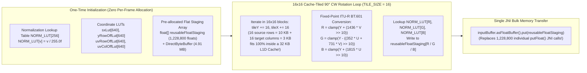
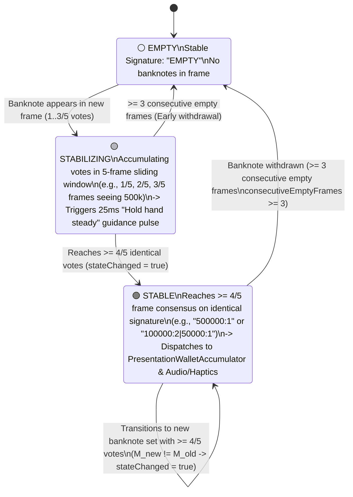
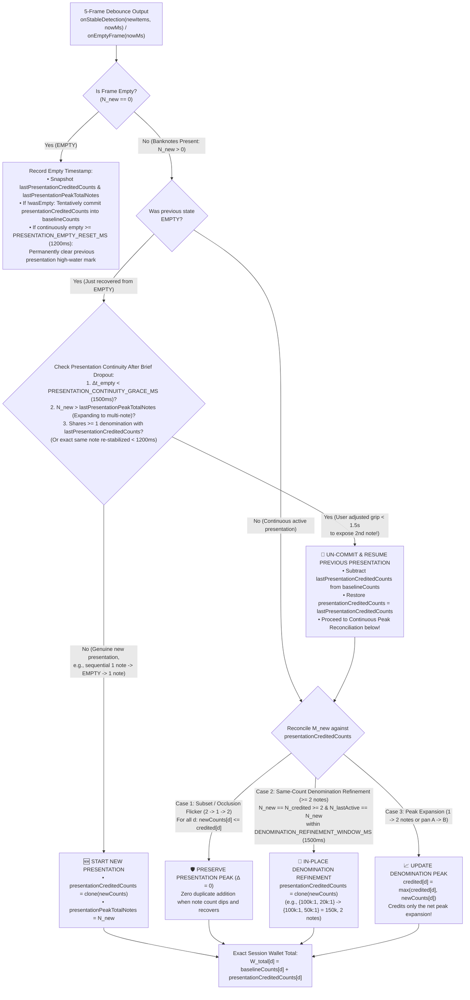
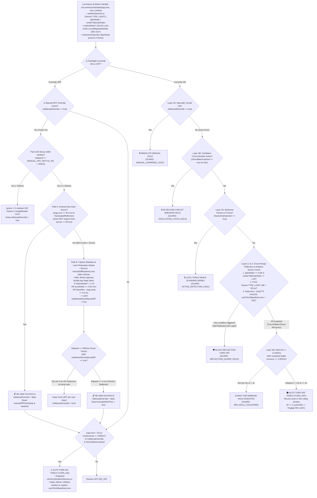
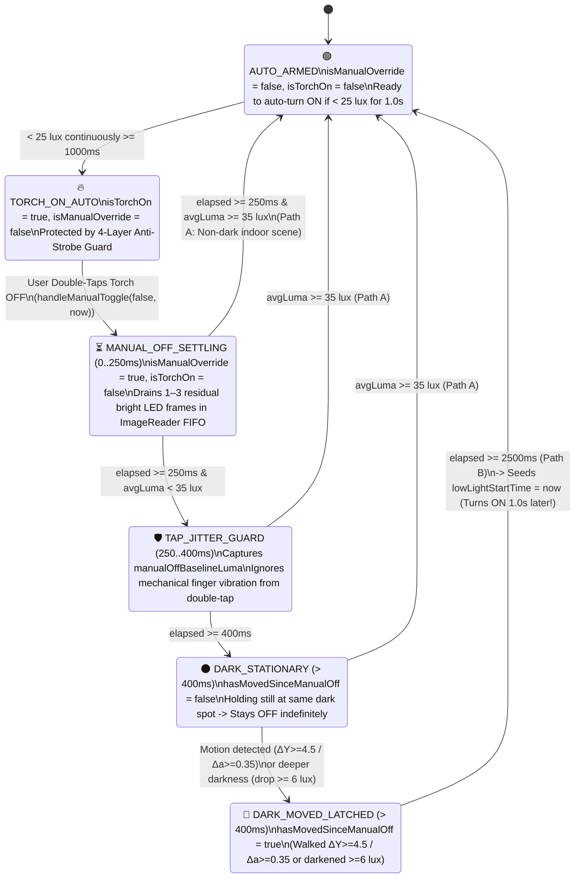
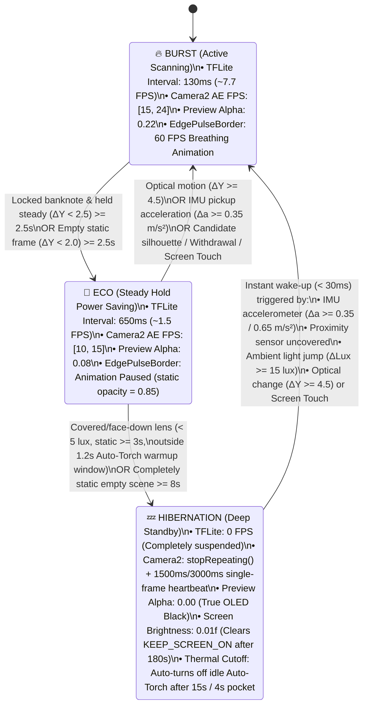
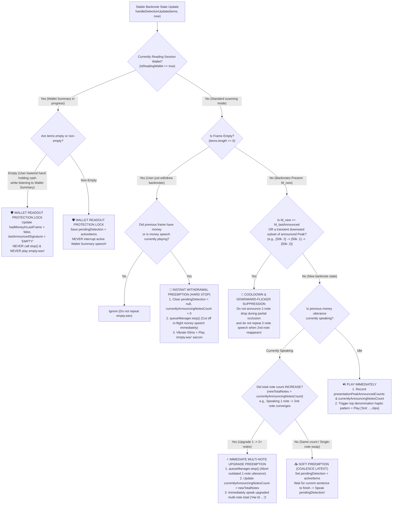
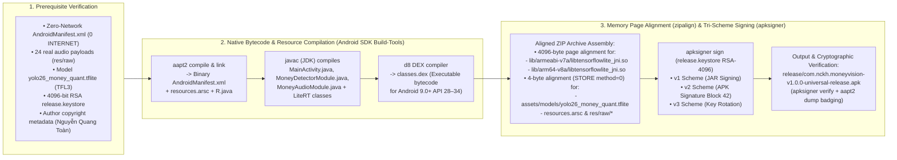

# System Architecture & Engineering Deep Dive

> **Language / Ngôn ngữ:** [Tiếng Việt](SYSTEM_ARCHITECTURE_AND_DESIGN.md) | **English (Current)**
>
> **Project:** **MoneyVision** (`com.nckh.moneyvision`)  
> **Author & Independent Owner:** **Nguyễn Quang Toàn** (`© 2026 Nguyễn Quang Toàn - Sở hữu & Phát triển độc lập`)  
> **OS Target Range:** **Android 9.0 Pie (`minSdkVersion = 28`)** $\rightarrow$ **Android 14+ (`targetSdkVersion = 34`)**  
> **Document Scope:** Deep-dive engineering analysis of the Dual-Runtime Architecture, Real-Time Zero-Copy Frame-to-Speech Pipeline, YOLO26n INT8 Computer Vision & L1 Data Cache Optimization, 5-Frame Temporal Debounce & Multi-Note Presentation Wallet Reconciliation (`PresentationWalletAccumulator`), 4-Layer Anti-Strobe & 2-Path Smart Manual-OFF Torch Recovery, 3-Tier Thermal & Battery Governor, Multi-Note Upgrade Preemption & Wallet Readout Protection Lock, and Universal APK Packaging (`v1+v2+v3`).

---

## 1. Dual-Runtime System Architecture

**MoneyVision** is engineered around a **1:1 synchronized Dual-Runtime Architecture** that simultaneously enables deterministic, high-speed unit/integration testing in TypeScript on Node.js (**`222 / 222` tests across 21 Suites** executing in ~18 seconds) and bare-metal hardware execution when compiled into Native Android bytecode (`classes.dex` + `libtensorflowlite_jni.so`):

1. **TypeScript / React Native Layer (`src/` & `App.tsx`)**:
   - Serves as the **Reference Architecture & React Native Bridge Layer**: every core algorithm (YOLO tensor decoding, Greedy NMS, 5-frame majority-vote debounce, `PresentationWalletAccumulator` peak reconciliation, 4-layer anti-strobe + 2-path manual-OFF torch recovery, 3-tier adaptive power governing, multi-note upgrade audio preemption & wallet readout lock, and multi-touch gesture recognition with per-pointer `16dp` palm rejection) is implemented in zero-dependency TypeScript and wired to Native Modules (`MoneyCameraView`, `MoneyDetectorModule`, `MoneyAudioModule`) via [`useMoneyState.ts`](file:///c:/Users/ADMIN/NCKH/App_android/src/hooks/useMoneyState.ts).
2. **Native Android Layer (`android/app/src/main/java/com/nckh/moneyvision/` & [`scripts/android-sdk-builder.mjs`](file:///c:/Users/ADMIN/NCKH/App_android/scripts/android-sdk-builder.mjs))**:
   - Executes directly on the Android 9.0+ ART runtime using the Camera2 / CameraX API, `SensorManager`, `PowerManager`, `AudioManager`, and the native C++ JNI `org.tensorflow.lite.Interpreter` (`libtensorflowlite_jni.so` bundled for both `armeabi-v7a` and `arm64-v8a`).

### 1.1. Real-Time End-to-End Frame-to-Speech Sequence Diagram

```mermaid
sequenceDiagram
    autonumber
    participant HAL as Camera2 / CameraX HAL\n(YUV_420_888 @ 15–24 FPS)
    participant Gate as Single-Pass Y Analyzer\n& 3-Tier Power Governor
    participant Torch as 4-Layer Anti-Strobe + 2-Path\nManual-OFF Recovery Torch
    participant Pre as 16x16 Cache-Tiled\nYUV-to-NCHW Preprocessor
    participant TFLite as LiteRT YOLO26n INT8\n(2-Thread XNNPACK)
    participant Dec as Row-Major Decoder, 5-Frame Debounce\n& PresentationWalletAccumulator
    participant Out as SmartPreemption Audio (Upgrade/Wallet Lock)\n& 9-Denom Tactile Haptics

    HAL->>Gate: onImageAvailable(ImageProxy / Image)
    Note over Gate: Always invoke image.close() inside a finally block\nto prevent Camera ISP buffer queue starvation
    Gate->>Gate: analyzeYPlaneSinglePass(Y-plane)\n-> avgLuma, glareRatio, centerToBorderRatio, LumaGrid16x16 (ΔY)
    Gate->>Torch: onLuminanceSample(avgLuma, now, { motionDeltaY, accelDelta, glareRatio, hasMoney })
    Note over Torch: • If isManualOverride && !isTorchOn (after 250ms settle):\n  - Path A: avgLuma >= 35 lux -> Clear override immediately\n  - Path B: Latch hasMovedSinceManualOff (ΔY>=4.5 / Δa>=0.35 / drop>=6 lux)\n    -> After 2.5s grace, clear override & re-trigger torch after 1.0s dark!
    Torch-->>HAL: Set FLASH_MODE_TORCH (4-layer anti-strobe + 2-path smart recovery)

    Gate->>Gate: evaluate(ΔY, accelDelta, proximity, thermalStatus, battery)
    alt In HIBERNATION, or interval not elapsed (130ms BURST / 650ms ECO), or ΔY > 32.0 (Motion Blur)
        Gate-->>HAL: Early image.close() (< 0.05ms CPU) — Skip TFLite inference
    else Inference interval elapsed & frame is sharp (ΔY <= 32.0)
        Gate->>Pre: Pass Y, U, V planes (640x480)
        Pre->>Pre: 16x16 Cache-Tiled 90° CW rotation + NORM_LUT[256] lookup\n-> Bulk copy into DirectByteBuffer [1, 3, 640, 640]
        Pre->>TFLite: interpreter.run(inputBuffer, outputTensor [1, 13, 8400])
        TFLite->>Dec: Return [1, 13, 8400] tensor
        Dec->>Dec: Row-Major Sparse Scan (c = 0..8)\n+ Greedy NMS (score >= 0.50, IoU >= 0.45)
        alt Early candidate silhouette (0.28 <= maxScore < 0.50) & not yet locked
            Dec->>Out: triggerCandidateGuidancePulse() -> 25ms haptic pulse ("Hold hand steady")
        end
        Dec->>Dec: TemporalDebounceFilter.process(items) (5-frame window, >= 4/5 consensus)
        alt Frame reaches STABLE (1 or more banknotes)
            Dec->>Dec: PresentationWalletAccumulator.onStableDetection(items, now)\n• Peak-set reconciliation (prevents double-counting across 2->1->2 flicker,\n  single-note pan, < 1.5s grip adjustment dropout, or >= 2-note refinement)
            Dec->>Out: handleDetectionUpdate(items, now)\n• If isReadingWallet == true: Store pendingDetection, DO NOT cut off wallet speech\n• If note count increases (1 -> 2 notes): Preempt 1-note speech immediately!\n• If transient downward dip (2 -> 1 note in same presentation): Stay silent!
        else >= 3 consecutive empty frames (M_new == EMPTY)
            Dec->>Dec: PresentationWalletAccumulator.onEmptyFrame(now)
            Dec->>Out: handleDetectionUpdate([], now)\n• If isReadingWallet == true: Protect wallet speech (NO stop(), NO empty.wav)\n• Otherwise: Instant stop() + Play empty.wav + 50ms haptic pulse
        end
    end
```

---

## 2. Subsystem 1: YOLO26n INT8 Computer Vision Pipeline & L1 Cache Optimization

Related source files:
- TypeScript: [`yoloConstants.ts`](file:///c:/Users/ADMIN/NCKH/App_android/src/services/detector/yoloConstants.ts), [`yoloDecoder.ts`](file:///c:/Users/ADMIN/NCKH/App_android/src/services/detector/yoloDecoder.ts), [`nmsAlgorithm.ts`](file:///c:/Users/ADMIN/NCKH/App_android/src/services/detector/nmsAlgorithm.ts)
- Native Android: [`Yolo26Detector.kt`](file:///c:/Users/ADMIN/NCKH/App_android/android/app/src/main/java/com/nckh/moneyvision/detector/Yolo26Detector.kt) and `MoneyDetectorModule.java` in [`scripts/android-sdk-builder.mjs`](file:///c:/Users/ADMIN/NCKH/App_android/scripts/android-sdk-builder.mjs)

### 2.1. `yolo26_money_quant.tflite` Tensor Specification & 9 Alphabetical Class Labels

The production model [`android/app/src/main/assets/models/yolo26_money_quant.tflite`](file:///c:/Users/ADMIN/NCKH/App_android/android/app/src/main/assets/models/yolo26_money_quant.tflite) (`2,888,643 bytes`, FlatBuffer `TFL3`) exposes:
- **Input Tensor**: `FLOAT32` of shape `[1, 3, 640, 640]` (Channels-First `NCHW`) or `[1, 640, 640, 3]` (Channels-Last `NHWC` — dynamically detected via `inputTensor.shape()`), normalized to $[0.0, 1.0]$.
- **Output Tensor**: `[1, 13, 8400]` (or `[1, 8400, 13]`), where $8,400$ is the total anchor count across 3 FPN feature scales ($80\times 80 + 40\times 40 + 20\times 20 = 8,400$) and the $13$ channels comprise:
  - Channels `0..3`: Bounding box center and dimensions (`cx, cy, w, h`).
  - Channels `4..12`: Class scores for the **9 Vietnamese banknote denominations** ordered alphabetically by label string (`YOLO_CLASS_ORDER`):

| Class Index (`classIndex`) | Tensor Channel (`channel`) | Label String (`YOLO_CLASS_ORDER`) | Numeric Value (`MoneyClass`) | Vietnamese Spoken Phrase |
| :---: | :---: | :---: | :---: | :--- |
| `0` | `4` | `"1000"` | `1000` | Một nghìn đồng (`1,000₫`) |
| `1` | `5` | `"10000"` | `10000` | Mười nghìn đồng (`10,000₫`) |
| `2` | `6` | `"100000"` | `100000` | Một trăm nghìn đồng (`100,000₫`) |
| `3` | `7` | `"2000"` | `2000` | Hai nghìn đồng (`2,000₫`) |
| `4` | `8` | `"20000"` | `20000` | Hai mươi nghìn đồng (`20,000₫`) |
| `5` | `9` | `"200000"` | `200000` | Hai trăm nghìn đồng (`200,000₫`) |
| `6` | `10` | `"5000"` | `5000` | Năm nghìn đồng (`5,000₫`) |
| `7` | `11` | `"50000"` | `50000` | Năm mươi nghìn đồng (`50,000₫`) |
| `8` | `12` | `"500000"` | `500000` | Năm trăm nghìn đồng (`500,000₫`) |

### 2.2. $16 \times 16$ Cache-Tiled 90° CW YUV420-to-NCHW Preprocessing

When holding the smartphone in portrait orientation, the raw rear-camera sensor frame (`640x480` Landscape) is rotated 90°. Populating the `[1, 3, 640, 640]` NCHW tensor requires simultaneous: **Aspect scaling $\rightarrow$ 90° Clockwise rotation $\rightarrow$ YUV-to-RGB color conversion normalized to $[0, 1]$ $\rightarrow$ Planar de-interleaving into 3 contiguous R, G, B planes (`planeSize = 640 * 640 = 409,600 floats`)**.

#### Why Naive Loops Cause Severe CPU Thermal Throttling
Iterating linearly over output coordinates `(outY, outX)` reads source row `srcY = 479 - syLut[outX]`, jumping backward by `640 bytes` on every single inner loop iteration! Conversely, iterating linearly over source `(srcY, srcX)` writes to `outIdx = outY * 640 + outX`, striding by `640 * 4 = 2,560 bytes` (a power-of-two multiple) across 3 separate planes and triggering catastrophic **L1 Data Cache Set-Associative Conflict Misses**.

#### $16 \times 16$ Cache-Tiled Solution (`convertYuv420ToNchwTiled` & `detectFromYuvFrame`)

### 2.3. Row-Major Sparse Decoder & Sub-2px Coordinate Noise Guard

In [`yoloDecoder.ts`](file:///c:/Users/ADMIN/NCKH/App_android/src/services/detector/yoloDecoder.ts), [`Yolo26Detector.kt`](file:///c:/Users/ADMIN/NCKH/App_android/android/app/src/main/java/com/nckh/moneyvision/detector/Yolo26Detector.kt), and `MoneyDetectorModule.java`, the `[1, 13, 8400]` output tensor is laid out in memory as `float[13][8400]`.

1. **100% Elimination of L1 Cache Thrashing via Row-Major Scanning**:
   - Instead of looping over anchor index `i = 0..8399` on the outside and jumping across 9 rows `matrix[4 + c][i]` on the inside (`75,600` strided jumps of `33,600 bytes`), the decoder loops over **class row `c = 0..8` on the outside** and scans each contiguous `row = matrix[4 + c]` linearly from `i = 0..8399` on the inside.
2. **Pre-Sigmoid Logit Gate & Sparse Hit Indexing (`reusableHitAnchors`)**:
   - Precomputes the inverse-sigmoid logit threshold $L_{\text{thresh}} = -\ln\left(\frac{1}{\text{thresh}} - 1\right)$. Only anchors exceeding the threshold are recorded in `reusableHitAnchors[0..hitCount-1]`.
   - **On empty frames (`hitCount == 0` — representing > 80% of runtime): the decoder returns immediately with `0` coordinate reads (`cx, cy, w, h`) and `0` calls to `Math.exp()`!**
3. **Automatic Coordinate Normalization Detection & `< 2px` Degenerate Box Rejection**:
   - The quantized YOLO26n INT8 model outputs normalized coordinates in $[0.0, 1.0]$. However, in a pixel-coordinate tensor $[0..640]$, a degenerate noise anchor can occasionally have coordinates $\le 1.5\text{px}$.
   - To prevent falsely scaling a $0.5\text{px}$ noise anchor by $640\times$ into a $320\text{px}$ phantom detection, the decoder checks `maxCoordVal` across `hitAnchors`; if `maxCoordVal <= 2.0f`, it verifies a strided sample across the tensor to distinguish with 100% precision between a **normalized $[0..1]$ tensor** and a **$< 2\text{px}$ noise anchor inside a pixel-coordinate tensor** (verified in Suite 13 & Suite 16 of [`scripts/test-runner.mjs`](file:///c:/Users/ADMIN/NCKH/App_android/scripts/test-runner.mjs)).

---

## 3. Subsystem 2: 5-Frame Temporal Debounce Filter & Presentation-Peak Wallet Accumulator (`TemporalDebounceFilter` & `PresentationWalletAccumulator`)

Related source files: [`src/services/debounce/TemporalDebounceFilter.ts`](file:///c:/Users/ADMIN/NCKH/App_android/src/services/debounce/TemporalDebounceFilter.ts), [`TemporalDebounceFilter.kt`](file:///c:/Users/ADMIN/NCKH/App_android/android/app/src/main/java/com/nckh/moneyvision/detector/TemporalDebounceFilter.kt), and `MainActivity.java` in [`scripts/android-sdk-builder.mjs`](file:///c:/Users/ADMIN/NCKH/App_android/scripts/android-sdk-builder.mjs).

When a blind user holds one or more banknotes in front of the lens, slight hand tremor can blur an individual frame or cause multiple banknotes to enter focus a few hundred milliseconds apart. This subsystem combines two layers: **5-Frame Sliding Window Majority Voting (`TemporalDebounceFilter`)** and **Presentation-Peak Wallet Reconciliation (`PresentationWalletAccumulator` — Ticket 13)**.

### 3.1. $N = 5$ Sliding Window & $\ge 4/5$ Majority Consensus State Machine

1. **Order-Invariant Canonical Signature (`computeDebounceSignature`)**:
   - Detections in a frame are aggregated by denomination and sorted ascending by `classId` into a deterministic string (e.g., two 50k notes and one 10k note always produce `"10000:1|50000:2"`).
2. **Single-Frame Hand-Jitter Immunity**:
   - Given 5 consecutive frames `[500k, 500k, EMPTY (tremor), 500k, 500k]`, the vote count for `"500000:1"` is $4/5 \ge 4 \rightarrow$ the state remains rock-solid at `STABLE` (`500k`) without cutting off audio.

### 3.2. Presentation-Peak Wallet Accumulator (`PresentationWalletAccumulator` — Ticket 13)

#### Why Frame-to-Frame Subtraction (`nextCount - prevCount`) Over-Counts Multi-Note Handfuls
When a blind user holds **2 banknotes** in front of the camera, four physical phenomena occur regularly:
1. **Sequential Convergence (`1 note -> 2 notes`)**: Note #1 is flatter and reaches $4/5$ consensus at $t = 0.5\text{s}$ (`{100k: 1}`); Note #2 reaches $4/5$ consensus at $t = 0.9\text{s}$ (`{100k: 2}`).
2. **Partial Occlusion Flicker (`2 notes -> 1 note -> 2 notes`) or Single-Note Panning (`{100k: 1} -> {200k: 1} -> {100k: 1, 200k: 1}`)**: If `currentNotes` is overwritten when the count dips to 1 note, then when the 2nd note reappears, naive `nextCount - prevCount` subtraction adds the 2nd note a second time (turning 2 notes into 3–4 notes!).
3. **Brief `< 1500ms` Empty Dropout During Grip Adjustment (`{100k: 1} -> EMPTY (600ms) -> {100k: 2}`)**: After hearing only 1 note announced, the user slightly shifts their fingers to expose the 2nd note, causing 3–5 empty frames (`~400–800ms`) before both notes appear (`{100k: 2}`). Resetting the presentation immediately on `EMPTY` would add both notes again (`100k + 200k = 300k`, 3 notes!).
4. **Same-Count Denomination Refinement for $\ge 2$ Notes (`{100k: 1, 20k: 1} -> {100k: 1, 50k: 1}`)**: At an initial oblique angle, a `50k` note is briefly classified as `20k` alongside a `100k` note (2 notes total), then stabilizes to `{100k: 1, 50k: 1}` (still 2 notes). Positive-only deltas would credit both `20k` and `50k` (`170k`, 3 notes).

#### Mathematical Model & Reconciliation Flowchart ($W_{\text{total}} = W_{\text{baseline}} \oplus M_{\text{presentation}}$)

[`PresentationWalletAccumulator`](file:///c:/Users/ADMIN/NCKH/App_android/src/services/debounce/TemporalDebounceFilter.ts) partitions the session wallet into **Completed Presentation Baselines (`baselineCounts`)** and the **Current Presentation Peak Set (`presentationCreditedCounts`)**:

---

## 4. Subsystem 3: 4-Layer Anti-Strobe Smart Torch & 2-Path Smart Manual-OFF Recovery (`Tickets 08 & 12`)

Related source files: [`src/services/camera/SmartTorchController.ts`](file:///c:/Users/ADMIN/NCKH/App_android/src/services/camera/SmartTorchController.ts), [`src/services/camera/LuminanceAnalyzer.ts`](file:///c:/Users/ADMIN/NCKH/App_android/src/services/camera/LuminanceAnalyzer.ts), [`MoneyCameraView.kt`](file:///c:/Users/ADMIN/NCKH/App_android/android/app/src/main/java/com/nckh/moneyvision/camera/MoneyCameraView.kt), and `MainActivity.java` in [`scripts/android-sdk-builder.mjs`](file:///c:/Users/ADMIN/NCKH/App_android/scripts/android-sdk-builder.mjs).

### 4.1. Two Opposing Optical Failure Modes in the Field

1. **Close-Range Optical Feedback Strobe Loop When Torch Is ON (`Ticket 08`)**:
   - In a dark room (`< 25 lux` for `1000ms`), Auto-Torch turns ON. As soon as a Polymer banknote is held 5–20 cm from the lens, LED light reflects off the glossy substrate back into the camera sensor, spiking `avgLuma` from `15 lux` to `180–245 lux`. A naive threshold (`avgLuma >= 60 lux` $\rightarrow$ turn OFF) enters an infinite strobe loop.
2. **Manual-OFF Lockout When Double-Tapping OFF and Running Back Into Darkness (`Ticket 12`)**:
   - After Auto-Torch turns ON, if the user double-taps to manually turn the torch OFF (`isManualOverride = true`), and then walks through an indoor hallway (`35–58 lux`, front sensor `< 85 lux`) or runs directly into another dark corner (`< 25 lux`), requiring the torch-ON anti-reflection threshold (`avgLuma >= 60 lux && ambientSensorLux >= 85 lux`) permanently locks `isManualOverride = true` so the torch never turns back on.
   - Conversely, clearing `isManualOverride` immediately while the user is still holding the phone stationary in the exact same dark spot would cause Auto-Torch to turn right back on `1 second` after the user explicitly turned it off.

### 4.2. Integrated Decision Flowchart: 4-Layer Anti-Strobe (When ON) & 2-Path Smart Recovery (When OFF)

### 4.3. Detailed State Machine of the `hasMovedSinceManualOff` Relocation Latch (`Ticket 12`)

Why is a persistent boolean latch **`hasMovedSinceManualOff`** required instead of checking instantaneous motion only at $t \ge 2500\text{ms}$?
- In practice, after double-tapping to turn off the torch at $t = 0\text{ms}$, a user typically walks or runs to a new dark spot during $t \in [600\text{ms}, 2000\text{ms}]$ and **stops moving** at $t = 2000\text{ms}$ to aim the camera at a banknote.
- Because `hasMovedSinceManualOff` latches as soon as physical movement occurs (after the `400ms` double-tap finger jitter guard) across either the optical $16\times 16$ Luma grid (`motionDeltaY >= 4.5`) or the hardware IMU listener (`motionSensorListener` with `deltaMag >= 0.35 m/s²`), when $t = 2500\text{ms}$ arrives, the controller remembers that the user relocated even though they are now standing still, immediately re-arming Auto-Torch!

---

## 5. Subsystem 4: 3-Tier Adaptive Thermal & Battery Governor (`AdaptivePowerGovernor`)

Related source files: [`src/services/camera/AdaptivePowerGovernor.ts`](file:///c:/Users/ADMIN/NCKH/App_android/src/services/camera/AdaptivePowerGovernor.ts), [`LuminanceAnalyzer.ts`](file:///c:/Users/ADMIN/NCKH/App_android/src/services/camera/LuminanceAnalyzer.ts), [`MoneyCameraView.kt`](file:///c:/Users/ADMIN/NCKH/App_android/android/app/src/main/java/com/nckh/moneyvision/camera/MoneyCameraView.kt), [`EdgePulseBorder.tsx`](file:///c:/Users/ADMIN/NCKH/App_android/src/components/EdgePulseBorder.tsx), and `MainActivity.java`.

### 5.1. 3-Tier Power State Machine (`BURST` / `ECO` / `HIBERNATION`)

### 5.2. Single-Pass Y-Plane Fusion (`analyzeYPlaneSinglePass`) & `MOTION_BLUR_GATE`

Instead of scanning the Y plane multiple times, [`analyzeYPlaneSinglePass`](file:///c:/Users/ADMIN/NCKH/App_android/src/services/camera/LuminanceAnalyzer.ts) performs **a single sparse-sampled pass** (`< 0.04ms` CPU) to compute simultaneously:
1. `averageLuma`, `centerLuma`, `borderLuma`, and `glareRatio` for Tickets 08 & 12.
2. **A $16 \times 16 = 256$-cell luminance grid (`lumaGrid`)** and the mean absolute temporal frame difference:
   $$\Delta Y = \frac{1}{256} \sum_{k=0}^{255} \left| G_t[k] - G_{t-1}[k] \right|$$
3. **Motion-Blur Gate (`MOTION_BLUR_GATE`, $\Delta Y > 32.0$)**:
   - When the user waves their hand or pans the phone rapidly ($\Delta Y > 32.0$), the camera frame suffers severe motion blur.
   - The governor keeps the state in `BURST` but **sets `shouldRunInference = false` for that blurred frame** and **skips feeding a false `EMPTY` into `TemporalDebounceFilter`**, saving 100% of wasted CPU/NPU cycles while preserving any already-locked banknote state inside the 5-frame window!

### 5.3. Zero-Permission Multi-Sensor Wake-Up & Adaptive IMU Table-Vibration Guard (`0.35 -> 0.65 m/s²`)

During `HIBERNATION`, continuous Camera2 frame streaming is halted via `captureSession.stopRepeating()` to power down the hardware ISP. To wake the pipeline instantaneously (`< 30ms`) as soon as the user picks up the phone without waiting for the `1500ms` heartbeat:
- The system registers 3 **Zero-Permission** hardware sensors (requiring zero declarations in `AndroidManifest.xml`): `Sensor.TYPE_LINEAR_ACCELERATION` (or `TYPE_ACCELEROMETER`), `Sensor.TYPE_PROXIMITY`, and `Sensor.TYPE_LIGHT`.
- **Adaptive IMU Table-Vibration Guard**:
  - The default IMU wake threshold is $\Delta a \ge 0.35\text{ m/s}^2$.
  - If the phone rests on a table vibrating from a desk fan or idling vehicle engine ($\Delta a \approx 0.40\text{–}0.50\text{ m/s}^2$) and triggers 3 consecutive IMU wake-ups without any corresponding optical scene change ($\Delta Y < 1.2$), `AdaptivePowerGovernor` automatically raises the IMU wake threshold to **`0.65 m/s²`** (`IMU_WAKE_DELTA_A_ADAPTIVE_TABLE`), eliminating false table-vibration wake-ups! As soon as real optical motion occurs ($\Delta Y \ge 4.5$), the threshold resets to `0.35 m/s²`.

### 5.4. Hardware Thermal & Battery Duty-Cycle Scaling Table (Android 9–14 / API 28–34)

Combines `PowerManager.getCurrentThermalStatus()` (API 29+) and `BatteryManager.EXTRA_TEMPERATURE` / `EXTRA_LEVEL` / `isPowerSaveMode()` (supported down to Android 9.0 API 28):

| Thermal Tier (`ThermalLevel`) | Trigger Condition (API 28–34) | `BURST` Interval | `ECO` Interval | Time to `ECO` | Time to `HIBERNATION` |
| :---: | :--- | :---: | :---: | :---: | :---: |
| **`NOMINAL`** | Battery temp $< 38.0^\circ\text{C}$, Battery $\ge 15\%$, `THERMAL_STATUS_NONE/LIGHT` | `130 ms` (~7.7 FPS) | `650 ms` (~1.5 FPS) | `2,500 ms` static | `8,000 ms` static empty |
| **`WARM`** | Battery temp $\ge 38.0^\circ\text{C}$ OR Battery $< 15\%$ OR Battery Saver ON OR `MODERATE` | `175 ms` (~5.7 FPS) | `850 ms` (~1.2 FPS) | `1,800 ms` static | `6,500 ms` static empty |
| **`HOT`** | Battery temp $\ge 41.0^\circ\text{C}$ OR `THERMAL_STATUS_SEVERE/CRITICAL` | `240 ms` (~4.1 FPS) | `1100 ms` (~0.9 FPS) | `1,200 ms` static | `5,000 ms` static empty |

---

## 6. Subsystem 5: Offline Vietnamese Audio Pipeline, Multi-Note Upgrade Preemption & Wallet Readout Lock (`SmartPreemptionController` — Ticket 13)

Related source files: [`src/services/audio/audioRegistry.ts`](file:///c:/Users/ADMIN/NCKH/App_android/src/services/audio/audioRegistry.ts), [`AudioQueueManager.ts`](file:///c:/Users/ADMIN/NCKH/App_android/src/services/audio/AudioQueueManager.ts), [`SmartPreemptionController.ts`](file:///c:/Users/ADMIN/NCKH/App_android/src/services/audio/SmartPreemptionController.ts), [`MoneyAudioModule.kt`](file:///c:/Users/ADMIN/NCKH/App_android/android/app/src/main/java/com/nckh/moneyvision/audio/MoneyAudioModule.kt), and `MoneyAudioModule.java`.

### 6.1. 24 Physical Audio Assets (`res/raw/`) & Natural Vietnamese Phrase Synthesis

The APK embeds **24 real physical audio files** (validated byte-for-byte via [`isRealAudioPayload`](file:///c:/Users/ADMIN/NCKH/App_android/src/services/audio/assetGenerator.ts) to reject silent/stub files):
- **9 denomination voice clips (`.mp3`)**: `vnd_1k.mp3` (*"Một nghìn"*) $\rightarrow$ `vnd_500k.mp3` (*"Năm trăm nghìn"*).
- **10 quantity voice clips (`.mp3`)**: `qty_1.mp3` (*"Một tờ"*) $\rightarrow$ `qty_10.mp3` (*"Mười tờ"*).
- **5 acoustic earcons (`.wav` 44.1kHz PCM)**: `tick.wav` (money locked), `empty.wav` (money withdrawn), `torch_on.wav`, `torch_off.wav`, `wallet_reset.wav`.

**Concise Phrasing Rules ([`buildDetectionAudioSequence`](file:///c:/Users/ADMIN/NCKH/App_android/src/services/audio/audioRegistry.ts)):**
- **Single Banknote**: Omits the redundant prefix *"Một tờ"* (*"One note"*), playing `['tick', 'vnd_500k']` (*"Tick — Five hundred thousand"*) directly to reduce utterance duration by 40%.
- **Multiple Banknotes**: Aggregates counts per denomination, sorts descending by value, and chains `[Quantity] + [Denomination]`. For example, two 200k notes and one 50k note $\rightarrow$ `['tick', 'qty_2', 'vnd_200k', 'qty_1', 'vnd_50k']` (*"Tick — Two notes two hundred thousand, one note fifty thousand"*).

### 6.2. Multi-Tier Smart Preemption Flowchart (`Smart Hybrid Preemption, Multi-Note Upgrade & Wallet Readout Lock`)

### 6.3. Three Core Audio Protection Mechanisms (`Ticket 13`)

1. **Wallet Readout Protection Lock (`isReadingWallet`)**:
   - When a blind user performs a 1-second `Long Press` (`handleLongPress`) or taps the **`👛 VÍ TÍCH LŨY`** card to hear their accumulated wallet total, their natural reflex is to **lower the hand holding the banknotes** while listening.
   - Lowering the hand causes the camera to emit `EMPTY` after 3 frames (`~390ms`). Because `isReadingWallet = true` is held across the entire wallet playback sequence (`try / finally` in TypeScript and `CompletionCallback` in `MoneyAudioModule.playSequence` in `MainActivity.java`), camera updates only synchronize background state variables and **never call `stop()` or play `empty.wav`**, ensuring the wallet summary finishes uninterrupted.
2. **Immediate Multi-Note Upgrade Preemption (`Multi-Note Upgrade Preemption`)**:
   - When holding two `50,000₫` notes, if Note #1 converges first (`t = 0.5s`) and begins speaking *"Năm mươi nghìn"*, and `200ms` later Note #2 converges (`newTotalNotes = 2 > currentlyAnnouncingNotesCount = 1`), the controller **immediately aborts the partial 1-note utterance** and speaks *"Hai tờ năm mươi nghìn"*. This prevents the user from hearing two separate consecutive announcements (*"Năm mươi nghìn"* followed by *"Hai tờ năm mươi nghìn"*), which would otherwise sound like 3 notes (`150,000₫`).
3. **Downward-Flicker Audio Suppression (`Downward-Flicker Suppression`)**:
   - The controller tracks the highest announced denomination counts in the active presentation via `presentationPeakAnnouncedCounts`. If the user is holding two `50,000₫` notes (already announced as *"Hai tờ năm mươi nghìn"*) and slight hand tremor briefly occludes one note (`{50k: 2} -> {50k: 1} -> {50k: 2}`), any subset `<= presentationPeakAnnouncedCounts` is kept completely silent.

---

## 7. Subsystem 6: Zero-Network Security Architecture & Universal Release APK Packaging Pipeline

Related source files: [`scripts/android-sdk-builder.mjs`](file:///c:/Users/ADMIN/NCKH/App_android/scripts/android-sdk-builder.mjs), [`scripts/build-release-apk.mjs`](file:///c:/Users/ADMIN/NCKH/App_android/scripts/build-release-apk.mjs), [`scripts/verify-apk-package.mjs`](file:///c:/Users/ADMIN/NCKH/App_android/scripts/verify-apk-package.mjs), [`android/app/build.gradle`](file:///c:/Users/ADMIN/NCKH/App_android/android/app/build.gradle), [`android/app/proguard-rules.pro`](file:///c:/Users/ADMIN/NCKH/App_android/android/app/proguard-rules.pro).

### 7.1. Standalone SDK Compilation & Offline APK Packaging Pipeline

### 7.2. Why Dual `4096-byte` and `4-byte` Alignment (`zipalign`) Is Mandatory

In [`scripts/build-release-apk.mjs`](file:///c:/Users/ADMIN/NCKH/App_android/scripts/build-release-apk.mjs) (`buildUniversalApkArchive`), the packager computes exact padding bytes (`extraField`) in each ZIP Local File Header to guarantee:
1. **`4096-byte` Page Alignment (`dataOffset % 4096 === 0`) for Uncompressed Native `.so` Libraries (`method = 0`)**:
   - On Android 9.0 through Android 14+ (`extractNativeLibs="false"`), the Bionic dynamic linker (`dlopen`) memory-maps (`mmap`) `lib/arm64-v8a/libtensorflowlite_jni.so` and `lib/armeabi-v7a/libtensorflowlite_jni.so` directly from the APK into virtual memory without extracting them to disk, saving tens of megabytes of flash storage and satisfying the Linux kernel's `4 KB` page alignment requirement.
2. **`4-byte` Alignment (`dataOffset % 4 === 0`) for `yolo26_money_quant.tflite`, `resources.arsc`, and `res/raw/*` (`method = 0`)**:
   - For `AssetManager.openFd("models/yolo26_money_quant.tflite")` to return a valid `AssetFileDescriptor` for TensorFlow Lite's zero-copy `MappedByteBuffer`, the `.tflite` file must be stored **uncompressed (`STORE / method = 0`)** at a 4-byte-aligned offset.

### 7.3. Broad Compatibility (Android 9.0+ / API 28) & Seamless In-Place Upgrades

- **Universal Dual-ABI (`32-bit` & `64-bit` ARM)**: By bundling both `lib/armeabi-v7a/` and `lib/arm64-v8a/` with `splits.abi.enable = false`, a single APK binary runs natively on both legacy 32-bit Android 9.0 budget phones and modern 64-bit Android 13/14 devices.
- **Persistent `release.keystore` Signature Preservation**: Every release build is signed with the deterministic 4096-bit RSA key at [`android/app/release.keystore`](file:///c:/Users/ADMIN/NCKH/App_android/android/app/release.keystore) across all three signing schemes (`v1 + v2 + v3`), allowing users to install updates directly over existing installations (`adb install -r` or direct APK file opening) without ever encountering `INSTALL_FAILED_UPDATE_INCOMPATIBLE`.
