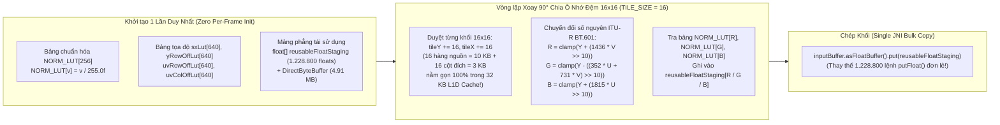
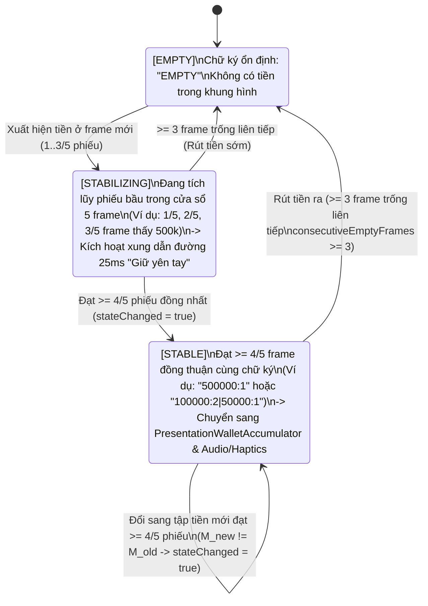
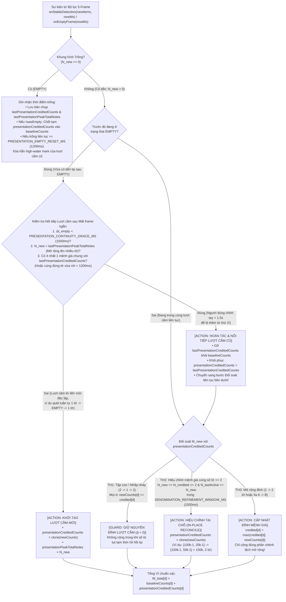
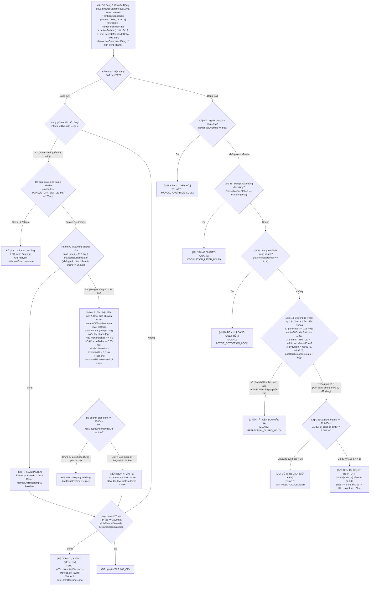
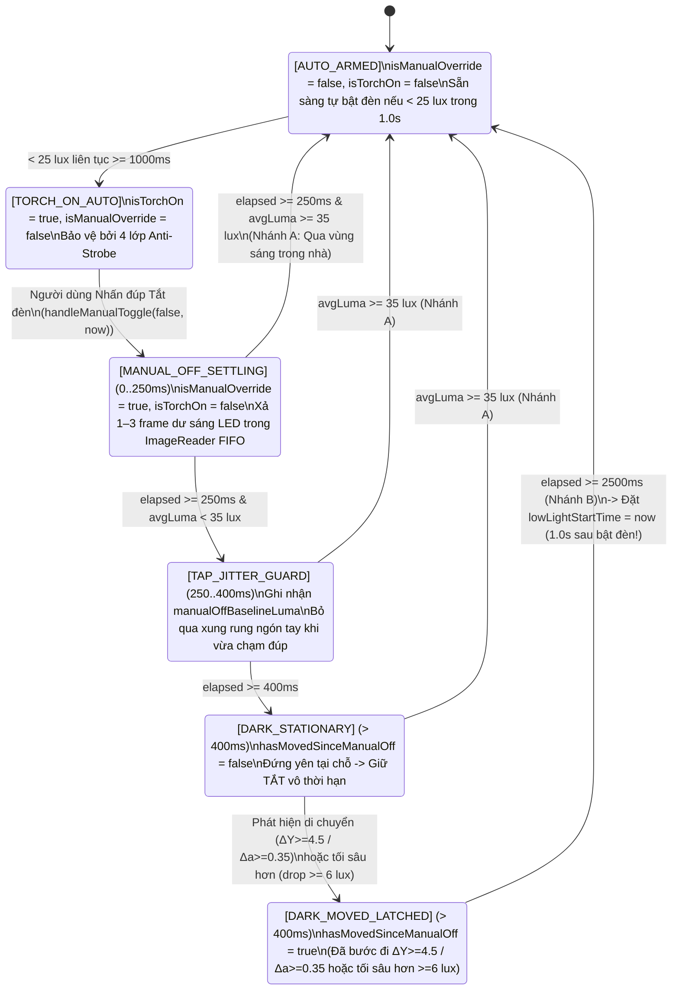
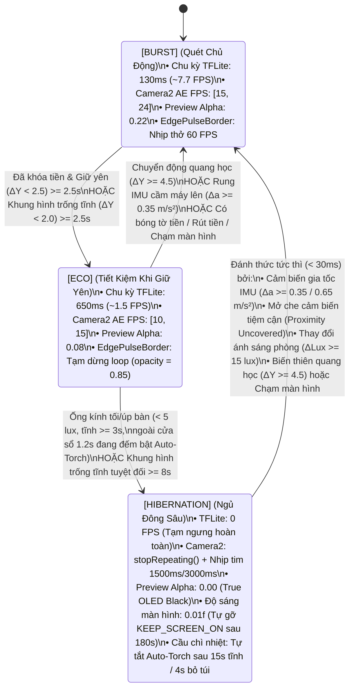
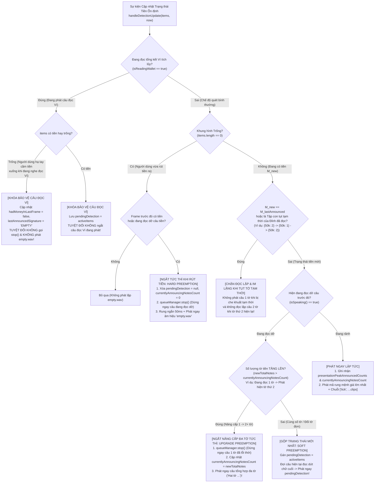
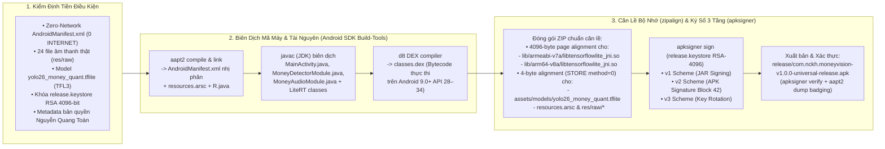

# Phân Tích Kiến Trúc Hệ Thống & Thiết Kế Kỹ Thuật Chuyên Sâu (System Architecture & Engineering Deep Dive)

> **Ngôn ngữ / Language:** **Tiếng Việt (Hiện tại)** | [English (`SYSTEM_ARCHITECTURE_AND_DESIGN.en.md`)](SYSTEM_ARCHITECTURE_AND_DESIGN.en.md)
>
> **Dự án:** **MoneyVision** (`com.nckh.moneyvision`)  
> **Tác giả & Chủ sở hữu độc lập:** **Nguyễn Quang Toàn** (`© 2026 Nguyễn Quang Toàn - Sở hữu & Phát triển độc lập`)  
> **Phạm vi hệ điều hành:** **Android 9.0 Pie (`minSdkVersion = 28`)** $\rightarrow$ **Android 14+ (`targetSdkVersion = 34`)**  
> **Phạm vi tài liệu:** Phân tích kiến trúc Dual-Runtime, Luồng dữ liệu thời gian thực (Zero-Copy Frame-to-Speech), Pipeline Thị giác máy tính YOLO26n INT8 & Tối ưu bộ nhớ đệm L1, Bộ lọc chống nhiễu 5 khung hình & Bộ đối soát Ví đa tờ (`PresentationWalletAccumulator`), Đèn Flash 4 lớp chống chớp tắt & Khôi phục tắt thủ công 2 nhánh, Bộ điều tốc nhiệt & pin 3 tầng, Hệ thống âm thanh Ngắt nâng cấp đa tờ / Khóa bảo vệ đọc Ví và Quy trình đóng gói Universal APK (`v1+v2+v3`).

---

## 1. Kiến Trúc Tổng Thể Hai Tầng Thực Thi (`Dual-Runtime System Architecture`)

**MoneyVision** được thiết kế với **kiến trúc song hành và đồng bộ hóa 1:1** giữa hai tầng thực thi để vừa đảm bảo khả năng kiểm thử đơn vị (Unit/Integration Testing) tốc độ cao bằng TypeScript trên Node.js (**`222 / 222` bài test trên 21 Suites** chạy trong ~18 giây), vừa đạt hiệu năng phần cứng tối đa khi đóng gói thành mã máy Native Android (`classes.dex` + `libtensorflowlite_jni.so`):

1. **Tầng TypeScript / React Native (`src/` & `App.tsx`)**:
   - Đóng vai trò là **Reference Architecture & React Native Bridge Layer**: toàn bộ thuật toán lõi (giải mã YOLO, NMS, lọc 5-frame, đối soát Ví theo lượt cầm `PresentationWalletAccumulator`, điều khiển đèn chống chói & tự khôi phục sau khi tắt thủ công, điều tốc năng lượng 3 tầng, hàng đợi âm thanh ngắt nâng cấp đa tờ & bảo vệ đọc Ví, cử chỉ đa điểm & lọc tì lòng bàn tay) được viết bằng TypeScript thuần túy không phụ thuộc thư viện ngoài, kết nối với Native Modules (`MoneyCameraView`, `MoneyDetectorModule`, `MoneyAudioModule`) thông qua [`useMoneyState.ts`](file:///c:/Users/ADMIN/NCKH/App_android/src/hooks/useMoneyState.ts).
2. **Tầng Native Android (`android/app/src/main/java/com/nckh/moneyvision/` & [`scripts/android-sdk-builder.mjs`](file:///c:/Users/ADMIN/NCKH/App_android/scripts/android-sdk-builder.mjs))**:
   - Thực thi trực tiếp trên máy ảo ART của Android 9.0+ với Camera2 / CameraX API, `SensorManager`, `PowerManager`, `AudioManager` và thư viện C++ JNI `org.tensorflow.lite.Interpreter` (`libtensorflowlite_jni.so` cho cả `armeabi-v7a` và `arm64-v8a`).

### 1.1. Sơ Đồ Tuần Tự Luồng Xử Lý Khung Hình Thời Gian Thực (`End-to-End Frame-to-Speech Sequence`)

```mermaid
sequenceDiagram
    autonumber
    participant HAL as Camera2 / CameraX HAL\n(YUV_420_888 @ 15–24 FPS)
    participant Gate as Single-Pass Y Analyzer\n& 3-Tier Power Governor
    participant Torch as 4-Layer Anti-Strobe + 2-Path\nManual-OFF Recovery Torch
    participant Pre as 16x16 Cache-Tiled\nYUV-to-NCHW Preprocessor
    participant TFLite as LiteRT YOLO26n INT8\n(2-Thread XNNPACK)
    participant Dec as Row-Major Decoder, 5-Frame Debounce\n& PresentationWalletAccumulator
    participant Out as SmartPreemption Audio (Upgrade/Wallet Lock)\n& 9-Denom Tactile Haptics

    HAL->>Gate: onImageAvailable(ImageProxy / Image)
    Note over Gate: Bắt buộc đóng image.close() trong khối finally\nđể không bao giờ làm nghẽn hàng đợi Camera ISP
    Gate->>Gate: analyzeYPlaneSinglePass(Y-plane)\n-> avgLuma, glareRatio, centerToBorderRatio, LumaGrid16x16 (ΔY)
    Gate->>Torch: onLuminanceSample(avgLuma, now, { motionDeltaY, accelDelta, glareRatio, hasMoney })
    Note over Torch: • Nếu isManualOverride && !isTorchOn (sau 250ms settle):\n  - Nhánh A: avgLuma >= 35 lux -> Gỡ override ngay\n  - Nhánh B: Chốt hasMovedSinceManualOff (ΔY>=4.5 / Δa>=0.35 / giảm >=6 lux)\n    -> Sau 2.5s mở khóa & giữ tối 1.0s bật lại đèn!
    Torch-->>HAL: Bật/Tắt FLASH_MODE_TORCH (4 lớp chống chói + khôi phục thông minh)

    Gate->>Gate: evaluate(ΔY, accelDelta, proximity, thermalStatus, battery)
    alt Đang ở HIBERNATION hoặc chưa tới chu kỳ (130ms BURST / 650ms ECO) hoặc ΔY > 32.0 (Motion Blur)
        Gate-->>HAL: Đóng sớm image.close() (< 0.05ms CPU) — Bỏ qua TFLite
    else Đến chu kỳ suy luận hợp lệ & Ảnh không bị nhòe (ΔY <= 32.0)
        Gate->>Pre: Truyền Y, U, V planes (640x480)
        Pre->>Pre: Xoay 90° CW theo ô 16x16 + tra bảng NORM_LUT[256]\n-> Chép khối vào DirectByteBuffer [1, 3, 640, 640]
        Pre->>TFLite: interpreter.run(inputBuffer, outputTensor [1, 13, 8400])
        TFLite->>Dec: Trả về mảng [1, 13, 8400]
        Dec->>Dec: Duyệt thưa theo hàng (Row-Major c=0..8)\n+ Greedy NMS (score >= 0.50, IoU >= 0.45)
        alt Có bóng tờ tiền sớm (0.28 <= maxScore < 0.50) & chưa khóa tiền
            Dec->>Out: triggerCandidateGuidancePulse() -> Rung nhẹ 25ms ("Giữ yên tay")
        end
        Dec->>Dec: TemporalDebounceFilter.process(items) (Cửa sổ 5 frame, đồng thuận >= 4/5)
        alt Khung hình đạt STABLE (1 hoặc nhiều tờ tiền)
            Dec->>Dec: PresentationWalletAccumulator.onStableDetection(items, now)\n• Đối soát đỉnh lượt cầm (chống cộng lặp khi flicker 2->1->2, lia cam,\n  mất frame < 1.5s khi chỉnh tay, hoặc hiệu chỉnh mệnh giá cùng số tờ >= 2)
            Dec->>Out: handleDetectionUpdate(items, now)\n• Nếu đang đọc Ví (isReadingWallet): Lưu pendingDetection, KHÔNG ngắt câu đọc Ví\n• Nếu tăng số tờ (1 -> 2 tờ): Ngắt ngay câu 1 tờ, đọc ngay câu 2 tờ!\n• Nếu tụt tạm thời (2 -> 1 tờ trong cùng lượt cầm): Giữ im lặng chống đọc lặp!
        else Khung hình trống liên tiếp >= 3 frame (M_new == EMPTY)
            Dec->>Dec: PresentationWalletAccumulator.onEmptyFrame(now)
            Dec->>Out: handleDetectionUpdate([], now)\n• Nếu isReadingWallet == true: Bảo vệ câu đọc Ví (KHÔNG gọi stop(), KHÔNG phát empty.wav)\n• Nếu không đọc Ví: stop() ngắt tức thì + Phát empty.wav + Rung 50ms
        end
    end
```

---

## 2. Phân Hệ 1: Pipeline Thị Giác Máy Tính YOLO26n INT8 & Tối Ưu Bộ Nhớ Đệm L1

Mã nguồn liên quan:
- TypeScript: [`yoloConstants.ts`](file:///c:/Users/ADMIN/NCKH/App_android/src/services/detector/yoloConstants.ts), [`yoloDecoder.ts`](file:///c:/Users/ADMIN/NCKH/App_android/src/services/detector/yoloDecoder.ts), [`nmsAlgorithm.ts`](file:///c:/Users/ADMIN/NCKH/App_android/src/services/detector/nmsAlgorithm.ts)
- Native Android: [`Yolo26Detector.kt`](file:///c:/Users/ADMIN/NCKH/App_android/android/app/src/main/java/com/nckh/moneyvision/detector/Yolo26Detector.kt) và `MoneyDetectorModule.java` trong [`scripts/android-sdk-builder.mjs`](file:///c:/Users/ADMIN/NCKH/App_android/scripts/android-sdk-builder.mjs)

### 2.1. Đặc Tả Mô Hình `yolo26_money_quant.tflite` & 9 Nhãn Tiền Tệ

File mô hình [`android/app/src/main/assets/models/yolo26_money_quant.tflite`](file:///c:/Users/ADMIN/NCKH/App_android/android/app/src/main/assets/models/yolo26_money_quant.tflite) (`2,888,643 bytes`, định dạng FlatBuffer `TFL3`) có cấu trúc:
- **Input Tensor**: `FLOAT32` kích thước `[1, 3, 640, 640]` (Channels-First `NCHW`) hoặc `[1, 640, 640, 3]` (Channels-Last `NHWC` — tự động phát hiện qua `inputTensor.shape()`). Giá trị điểm ảnh chuẩn hóa về đoạn $[0.0, 1.0]$.
- **Output Tensor**: `[1, 13, 8400]` (hoặc `[1, 8400, 13]`), trong đó $8.400$ là tổng số anchor trên 3 tầng đặc trưng ($80\times 80 + 40\times 40 + 20\times 20 = 8.400$) và $13$ kênh gồm:
  - Kênh `0..3`: Tọa độ tâm và kích thước hộp giới hạn (`cx, cy, w, h`).
  - Kênh `4..12`: Điểm số của **9 lớp mệnh giá tiền Việt Nam** được huấn luyện theo thứ tự từ điển chữ cái (Alphabetical Sorting):

| Chỉ số lớp (`classIndex`) | Kênh Tensor (`channel`) | Chuỗi nhãn (`YOLO_CLASS_ORDER`) | Giá trị số (`MoneyClass`) | Tên đọc tiếng Việt |
| :---: | :---: | :---: | :---: | :--- |
| `0` | `4` | `"1000"` | `1000` | Một nghìn đồng |
| `1` | `5` | `"10000"` | `10000` | Mười nghìn đồng |
| `2` | `6` | `"100000"` | `100000` | Một trăm nghìn đồng |
| `3` | `7` | `"2000"` | `2000` | Hai nghìn đồng |
| `4` | `8` | `"20000"` | `20000` | Hai mươi nghìn đồng |
| `5` | `9` | `"200000"` | `200000` | Hai trăm nghìn đồng |
| `6` | `10` | `"5000"` | `5000` | Năm nghìn đồng |
| `7` | `11` | `"50000"` | `50000` | Năm mươi nghìn đồng |
| `8` | `12` | `"500000"` | `500000` | Năm trăm nghìn đồng |

### 2.2. Tiền Xử Lý YUV420-sang-NCHW Xoay 90° Theo Ô Nhớ Đệm $16 \times 16$ (`Cache-Tiled Rotation`)

Khi cầm điện thoại dọc (Portrait), ảnh thu từ cảm biến Camera sau (`640x480` Landscape) bị xoay ngang 90°. Để đưa vào tensor NCHW `[1, 3, 640, 640]`, hệ thống phải thực hiện đồng thời: **Co giãn tỷ lệ $\rightarrow$ Xoay 90° cùng chiều kim đồng hồ $\rightarrow$ Chuyển hệ màu YUV sang RGB chuẩn hóa $[0, 1]$ $\rightarrow$ Tách thành 3 mặt phẳng R, G, B liên tiếp (`planeSize = 640 * 640 = 409,600 floats`)**.

#### Tại sao cách duyệt vòng lặp thông thường gây nóng CPU?
Nếu duyệt tuyến tính theo tọa độ đầu ra `(outY, outX)`, tọa độ đọc trên ảnh gốc `srcY = 479 - syLut[outX]` nhảy ngược từng hàng `640 bytes` trên mỗi bước tăng `outX`! Ngược lại, nếu duyệt tuyến tính theo ảnh gốc `(srcY, srcX)` rồi ghi ra `outIdx = outY * 640 + outX`, con trỏ ghi nhảy cách quãng `640 * 4 = 2.560 bytes` (bội số lũy thừa của 2), gây **L1 Data Cache Set-Associative Conflict Miss** nghiêm trọng trên cả 3 mặt phẳng R, G, B.

#### Giải pháp Tối ưu Bộ nhớ Đệm $16 \times 16$ (`convertYuv420ToNchwTiled` & `detectFromYuvFrame`)

### 2.3. Giải Mã Thưa Theo Hàng (`Row-Major Sparse Decoder`) & Lọc Nhiễu Tọa Độ

Trong [`yoloDecoder.ts`](file:///c:/Users/ADMIN/NCKH/App_android/src/services/detector/yoloDecoder.ts), [`Yolo26Detector.kt`](file:///c:/Users/ADMIN/NCKH/App_android/android/app/src/main/java/com/nckh/moneyvision/detector/Yolo26Detector.kt) và `MoneyDetectorModule.java`, tensor đầu ra `[1, 13, 8400]` trong bộ nhớ là mảng `float[13][8400]`.

1. **Loại bỏ 100% L1 Cache Thrashing nhờ Duyệt Theo Hàng (`Row-Major Scanning`)**:
   - Thay vì duyệt `for i in 0..8399` ở ngoài rồi nhảy qua 9 hàng `matrix[4 + c][i]` ở trong (gây `75.600` lần nhảy bước `33.600 bytes`), bộ giải mã duyệt **theo từng hàng lớp `c = 0..8` ở vòng ngoài** và quét tuần tự mảng liên tiếp `row = matrix[4 + c]` từ `i = 0..8399` ở vòng trong.
2. **Lọc Sớm Trước Sigmoid (`Pre-Sigmoid Logit Gate`) & Đánh Dấu Thưa (`reusableHitAnchors`)**:
   - Tính sẵn ngưỡng logit nghịch đảo $L_{\text{thresh}} = -\ln\left(\frac{1}{\text{thresh}} - 1\right)$. Chỉ những phần tử vượt ngưỡng mới được ghi vào danh sách chỉ số trúng `reusableHitAnchors[0..hitCount-1]`.
   - **Khi khung hình trống (`hitCount == 0` — chiếm > 80% thời gian chờ): hàm trả về ngay lập tức với `0` lượt đọc tọa độ (`cx, cy, w, h`) và `0` lệnh gọi `Math.exp()`!**
3. **Tự Động Nhận Diện Tọa Độ Chuẩn Hóa (`_NormalizeCoords`) & Chống Nhiễu `< 2px`**:
   - Mô hình YOLO26n INT8 xuất tọa độ đã chuẩn hóa về $[0.0, 1.0]$. Tuy nhiên, trong một tensor tọa độ pixel $[0..640]$, có thể xuất hiện một vài anchor nhiễu suy biến có tọa độ cực nhỏ $\le 1.5\text{px}$.
   - Để không bao giờ nhân nhầm một box nhiễu $0.5\text{px}$ lên $640$ lần thành box giả $320\text{px}$, thuật toán kiểm tra `maxCoordVal` trên các `hitAnchors`; nếu `maxCoordVal <= 2.0f`, nó quét xác nhận thêm một mẫu bước nhảy trên toàn tensor để phân biệt chính xác 100% giữa **tensor chuẩn hóa $[0..1]$** và **box nhiễu $< 2\text{px}$ trong tensor pixel** (được kiểm chứng tại Suite 13 & Suite 16 trong [`scripts/test-runner.mjs`](file:///c:/Users/ADMIN/NCKH/App_android/scripts/test-runner.mjs)).

---

## 3. Phân Hệ 2: Bộ Lọc Trạng Thái Ổn Định 5 Khung Hình & Bộ Đối Soát Ví Theo Lượt Cầm (`TemporalDebounceFilter` & `PresentationWalletAccumulator`)

Mã nguồn: [`src/services/debounce/TemporalDebounceFilter.ts`](file:///c:/Users/ADMIN/NCKH/App_android/src/services/debounce/TemporalDebounceFilter.ts), [`TemporalDebounceFilter.kt`](file:///c:/Users/ADMIN/NCKH/App_android/android/app/src/main/java/com/nckh/moneyvision/detector/TemporalDebounceFilter.kt) và `MainActivity.java` trong [`scripts/android-sdk-builder.mjs`](file:///c:/Users/ADMIN/NCKH/App_android/scripts/android-sdk-builder.mjs).

Khi người khiếm thị cầm 1 hoặc nhiều tờ tiền trước ống kính, tay có thể rung nhẹ làm 1 frame bị nhòe hoặc các tờ tiền vào khung ngắm lệch nhịp nhau vài trăm mili-giây. Phân hệ này gồm 2 tầng: **Bộ lọc đồng thuận 5 khung hình (`TemporalDebounceFilter`)** và **Bộ đối soát Ví theo Đỉnh Lượt cầm (`PresentationWalletAccumulator`)**.

### 3.1. Cơ Chế Cửa Sổ Trượt $N = 5$ & Bỏ Phiếu Đa Số ($\ge 4/5$ Consensus)

1. **Chữ ký chính tắc bất biến thứ tự (`computeDebounceSignature`)**:
   - Tập hợp các tờ tiền trong 1 frame được gộp theo mệnh giá và sắp xếp tăng dần theo `classId`, tạo thành chuỗi duy nhất (ví dụ: 2 tờ 50k và 1 tờ 10k luôn sinh ra `"10000:1|50000:2"`).
2. **Chống Rung Tay 1 Frame (`Jitter Immunity`)**:
   - Giả sử chuỗi 5 frame liên tiếp là: `[500k, 500k, EMPTY (rung tay), 500k, 500k]`. Số phiếu cho `"500000:1"` là $4/5 \ge 4 \rightarrow$ trạng thái vẫn giữ vững là `STABLE` (`500k`), không bị ngắt âm thanh.

### 3.2. Bộ Đối Soát Ví Theo Đỉnh Lượt Cầm (`PresentationWalletAccumulator`)

#### Tại sao phép trừ giữa 2 frame liền kề (`nextCount - prevCount`) bị cộng dồn thừa khi cầm nhiều tờ tiền?
Khi người khiếm thị cầm **2 tờ tiền** trên tay, 4 hiện tượng vật lý thực tế thường xuyên xảy ra:
1. **Hội tụ tuần tự (`1 tờ -> 2 tờ`)**: Tờ thứ nhất phẳng hơn nên đạt $4/5$ frame ở $t = 0.5\text{s}$ (`{100k: 1}`), tờ thứ hai đạt $4/5$ frame ở $t = 0.9\text{s}$ (`{100k: 2}`).
2. **Nhấp nháy che khuất một phần (`2 tờ -> 1 tờ -> 2 tờ`) hoặc lia đơn lẻ (`{100k: 1} -> {200k: 1} -> {100k: 1, 200k: 1}`)**: Nếu ghi đè `currentNotes` ngay khi số tờ giảm tạm thời về 1 tờ, thì khi tờ thứ 2 hiện lại, phép trừ `nextCount - prevCount` sẽ cộng tờ thứ 2 thêm một lần nữa (2 tờ thành 3–4 tờ!).
3. **Mất frame ngắn `< 1500ms` khi chỉnh lại thế cầm (`{100k: 1} -> EMPTY (600ms) -> {100k: 2}`)**: Khi máy mới đọc 1 tờ, người dùng dịch nhẹ tay để lộ tờ thứ 2 làm lọt 3–5 frame trống (`~400–800ms`) trước khi máy thấy cả 2 tờ. Nếu xóa sạch phiên ngay ở frame `EMPTY`, lúc thấy `{100k: 2}` máy sẽ cộng thêm cả 2 tờ vào ví (`100k + 200k = 300k`, 3 tờ!).
4. **Hiệu chỉnh mệnh giá cùng tổng số tờ $\ge 2$ (`{100k: 1, 20k: 1} -> {100k: 1, 50k: 1}`)**: Ở góc nghiêng ban đầu tờ `50k` bị nhìn nhầm thành `20k` (tổng 2 tờ), ngay sau đó hội tụ đúng thành `{100k: 1, 50k: 1}` (vẫn 2 tờ). Nếu chỉ cộng dương, ví sẽ cộng cả `20k` lẫn `50k` thành 3 tờ (`170k`).

#### Mô hình Toán học & Sơ đồ Luồng Đối soát $W_{\text{total}} = W_{\text{baseline}} \oplus M_{\text{presentation}}$

Lớp [`PresentationWalletAccumulator`](file:///c:/Users/ADMIN/NCKH/App_android/src/services/debounce/TemporalDebounceFilter.ts) tách biệt trạng thái Ví thành **Nền các lượt cầm đã hoàn tất (`baselineCounts`)** và **Tập đỉnh của lượt cầm hiện tại (`presentationCreditedCounts`)**:

---

## 4. Phân Hệ 3: Đèn Flash Thông Minh 4 Lớp Chống Chớp Tắt & Khôi Phục Tắt Thủ Công Hai Nhánh (`Anti-Strobe & 2-Path Manual-OFF Recovery`)

Mã nguồn: [`src/services/camera/SmartTorchController.ts`](file:///c:/Users/ADMIN/NCKH/App_android/src/services/camera/SmartTorchController.ts), [`src/services/camera/LuminanceAnalyzer.ts`](file:///c:/Users/ADMIN/NCKH/App_android/src/services/camera/LuminanceAnalyzer.ts), [`MoneyCameraView.kt`](file:///c:/Users/ADMIN/NCKH/App_android/android/app/src/main/java/com/nckh/moneyvision/camera/MoneyCameraView.kt) và `MainActivity.java` trong [`scripts/android-sdk-builder.mjs`](file:///c:/Users/ADMIN/NCKH/App_android/scripts/android-sdk-builder.mjs).

### 4.1. Hai Bài Toán Quang Học Đối Nghịch Trên Thực Địa

1. **Hiện tượng Tự kích Quang học khi Đèn đang BẬT (`Optical Feedback Strobe Loop`)**:
   - Khi đứng trong phòng tối (`< 25 lux` trong `1000ms`), đèn Flash tự động bật. Ngay khi đưa tờ tiền Polymer lại gần ống kính (5–20 cm), ánh sáng từ đèn LED Flash phản xạ ngược vào cảm biến camera làm `avgLuma` vọt từ `15 lux` lên `180–245 lux`. Nếu bộ điều khiển chỉ so sánh `avgLuma >= 60 lux` để tắt đèn, đèn sẽ chớp tắt liên tục (Strobe Loop).
2. **Hiện tượng Khóa chết Cờ Tắt thủ công khi Người dùng Nhấn đúp Tắt đèn rồi Chạy vào Vùng tối lại (`Manual-OFF Lockout`)**:
   - Khi Auto-Torch đã bật, nếu người dùng nhấn đúp 2 lần để tắt đèn thủ công (`isManualOverride = true`), sau đó đi qua hành lang trong nhà (`35–58 lux`, cảm biến mặt trước `< 85 lux`) hoặc chạy thẳng sang một góc tối khác (`< 25 lux`), điều kiện cũ đòi hỏi `avgLuma >= 60 lux && ambientSensorLux >= 85 lux` sẽ không bao giờ thỏa mãn, làm đèn không thể tự bật lại.
   - Ngược lại, nếu vừa tắt đèn ở chỗ tối mà mở khóa lại ngay lập tức khi người dùng vẫn đang đứng yên ở đúng chỗ đó, đèn sẽ tự bật lại sau 1 giây trái ý muốn tắt đèn của người dùng.

### 4.2. Sơ Đồ Quyết Định Tích Hợp: 4 Lớp Chống Chớp Tắt (Khi Đèn BẬT) & 2 Nhánh Khôi Phục Thông Minh (Khi Đèn TẮT)

### 4.3. Máy Trạng Thái Chi Tiết Của Chốt Hành Trình `hasMovedSinceManualOff` (`Relocation Latch`)

Tại sao phải dùng chốt trạng thái **`hasMovedSinceManualOff`** thay vì chỉ kiểm tra chuyển động tại thời điểm $t \ge 2500\text{ms}$?
- Trong thực tế, sau khi nhấn đúp tắt đèn ở $t = 0\text{ms}$, người dùng thường bước đi/chạy sang góc tối mới trong khoảng $t \in [600\text{ms}, 2000\text{ms}]$, sau đó **đứng yên lại** ở $t = 2000\text{ms}$ để giơ tờ tiền lên quét.
- Nhờ chốt `hasMovedSinceManualOff` được gài ngay khi phát hiện chuyển động (sau ngưỡng chống rung ngón tay `400ms`) trên cả luồng ảnh (`motionDeltaY >= 4.5`) lẫn luồng cảm biến gia tốc phần cứng (`motionSensorListener` với `deltaMag >= 0.35 m/s²`), đến mốc $t = 2500\text{ms}$ dù người dùng đã đứng yên, hệ thống vẫn biết chắc chắn người dùng đã di chuyển sang vị trí mới và tự động mở khóa để bật đèn sau `1000ms`!

---

## 5. Phân Hệ 4: Bộ Điều Tốc Năng Lượng & Nhiệt Độ 3 Tầng (`AdaptivePowerGovernor`)

Mã nguồn: [`src/services/camera/AdaptivePowerGovernor.ts`](file:///c:/Users/ADMIN/NCKH/App_android/src/services/camera/AdaptivePowerGovernor.ts), [`LuminanceAnalyzer.ts`](file:///c:/Users/ADMIN/NCKH/App_android/src/services/camera/LuminanceAnalyzer.ts), [`MoneyCameraView.kt`](file:///c:/Users/ADMIN/NCKH/App_android/android/app/src/main/java/com/nckh/moneyvision/camera/MoneyCameraView.kt), [`EdgePulseBorder.tsx`](file:///c:/Users/ADMIN/NCKH/App_android/src/components/EdgePulseBorder.tsx) và `MainActivity.java`.

### 5.1. Máy Trạng Thái Năng Lượng 3 Tầng (`BURST` / `ECO` / `HIBERNATION`)

### 5.2. Hợp Nhất Phân Tích Kênh Y Trong 1 Vòng Lặp (`analyzeYPlaneSinglePass`) & Cổng Chặn Nhòe (`MOTION_BLUR_GATE`)

Thay vì quét mặt phẳng Y nhiều lần, hàm [`analyzeYPlaneSinglePass`](file:///c:/Users/ADMIN/NCKH/App_android/src/services/camera/LuminanceAnalyzer.ts) thực hiện duy nhất **1 vòng lặp lấy mẫu thưa** (`< 0.04ms` CPU) để tính đồng thời:
1. Độ sáng trung bình `averageLuma`, độ sáng tâm `centerLuma`, độ sáng viền `borderLuma`, và tỷ lệ điểm chói `glareRatio` cho bộ điều khiển Đèn Flash chống chớp tắt và khôi phục tắt thủ công.
2. **Lưới độ sáng $16 \times 16 = 256$ ô (`lumaGrid`)** và độ lệch chuyển động trung bình so với frame trước:
   $$\Delta Y = \frac{1}{256} \sum_{k=0}^{255} \left| G_t[k] - G_{t-1}[k] \right|$$
3. **Cổng Chặn Nhòe Chuyển Động (`MOTION_BLUR_GATE`, $\Delta Y > 32.0$)**:
   - Khi người dùng đang vẩy tay hoặc lia máy quá nhanh ($\Delta Y > 32.0$), hình ảnh bị nhòe nặng (motion blur).
   - Bộ điều tốc giữ hệ thống ở trạng thái `BURST` nhưng **đặt `shouldRunInference = false` cho frame nhòe đó** và **không đẩy frame rỗng giả vào `TemporalDebounceFilter`**, giúp tiết kiệm 100% chu kỳ CPU/NPU vô ích mà không làm rơi mất trạng thái tiền đã khóa trong cửa sổ 5 frame!

### 5.3. Tối Ưu Hóa Chế Độ Eco Mode: Bộ Trễ Vùng Đệm 350ms, Chống Rung Bàn Tay & Chặn Mất Frame Âm Tính Giả

Nhằm đảm bảo chế độ `ECO` hoạt động ổn định trên thiết bị cầm tay thực tế mà không bị thoát giả về `BURST` bởi các xung nhiễu vi mô:
1. **Bộ trễ vùng đệm chống dao động Eco Mode (`Eco Mode Deadband Hysteresis 350ms`)**:
   - Khi đang ở `ECO`, nếu biên độ chuyển động quang học nằm trong vùng đệm giữa tĩnh và vung tay chủ động (`STATIC_HOLDING_DELTA_Y_THRESHOLD < motionDeltaY < MOTION_WAKE_DELTA_Y_THRESHOLD = 4.5`), `AdaptivePowerGovernor` khởi động đồng hồ đệm `ecoMotionSpikeStartMs`.
   - Chuyển động phải duy trì liên tục tối thiểu **`350ms`** mới cho phép thoát `ECO` về `BURST`. Các rung động giật ngón tay hoặc dịch chuyển nhẹ $< 350\text{ms}$ sẽ bị hấp thụ hoàn toàn. Những chuyển động chủ động biên độ lớn ($\Delta Y \ge 4.5$) tiếp tục đánh thức hệ thống về `BURST` ngay lập tức trong 1 frame ($< 15\text{ms}$).
2. **Bộ lọc rung lắc bàn tay người khiếm thị (`Hand-Tremor IMU Filter 0.65 m/s²`)**:
   - Trong `MoneyCameraView.kt`, khi tiền đã được xác nhận ổn định (`hasConfirmedMoney == true`), ngưỡng gia tốc IMU để đánh thức máy được nâng từ `0.35 m/s²` lên **`0.65 m/s²`** (`IMU_WAKE_DELTA_A_TABLE`). Cơ chế này loại bỏ rung giật sinh lý tự nhiên của tay người dùng khi cầm tiền đứng yên trước ống kính, ngăn chặn triệt để hiện tượng vọt thoát `ECO` không mong muốn.
3. **Bảo vệ chống mất frame âm tính giả của mô hình AI (`effectiveConsecutiveEmpty = 0`)**:
   - Trong [`useMoneyState.ts`](file:///c:/Users/ADMIN/NCKH/App_android/src/hooks/useMoneyState.ts), khi trạng thái nhận diện đang ổn định (`STABLE`) và tiền đang được giữ yên trước camera (`motionDeltaY < STATIC_HOLDING_DELTA_Y_THRESHOLD`), nếu mô hình YOLO xuất hiện hiện tượng sụt 1 frame âm tính giả (False Negative Dropout), hệ thống truyền `effectiveConsecutiveEmpty = 0` vào bộ điều tốc thay vì nhận diện sai là người dùng đang rút tiền (`WITHDRAWAL_TRANSITION`), bảo toàn chế độ `ECO` tiết kiệm pin.

### 5.4. Đánh Thức Đa Cảm Biến Không Cần Quyền & Bộ Lọc Chống Rung Mặt Bàn (`0.35 -> 0.65 m/s²`)

Khi ở trạng thái `HIBERNATION`, luồng bơm frame liên tục của Camera2 được dừng hẳn bằng `captureSession.stopRepeating()` để giải phóng hoàn toàn ISP (Image Signal Processor). Để đánh thức máy tức thì ngay khi người dùng vừa nhấc máy lên mà không cần đợi chu kỳ nhịp tim `1500ms`:
- Hệ thống lắng nghe 3 cảm biến phần cứng **Zero-Permission** (không cần khai báo quyền trong `AndroidManifest.xml`): `Sensor.TYPE_LINEAR_ACCELERATION` (hoặc `TYPE_ACCELEROMETER`), `Sensor.TYPE_PROXIMITY`, và `Sensor.TYPE_LIGHT`.
- **Bộ lọc Thích ứng Chống Rung Mặt Bàn (`Adaptive IMU Table-Vibration Guard`)**:
   - Ngưỡng đánh thức mặc định của cảm biến gia tốc là $\Delta a \ge 0.35\text{ m/s}^2$.
   - Nếu điện thoại đặt trên mặt bàn có quạt máy hoặc trên xe đang nổ máy gây rung nhẹ ($\Delta a \approx 0.40\text{–}0.50\text{ m/s}^2$) làm máy thức dậy 3 lần liên tiếp mà không hề có biến thiên hình ảnh quang học ($\Delta Y < 1.2$), `AdaptivePowerGovernor` sẽ tự động nâng ngưỡng đánh thức IMU lên **`0.65 m/s²`** (`IMU_WAKE_DELTA_A_ADAPTIVE_TABLE`), chặn đứng hoàn toàn việc thức dậy giả do rung bàn! Ngay khi người dùng cầm máy lên thật ($\Delta Y \ge 4.5$), ngưỡng tự động trở về `0.35 m/s²`.

### 5.5. Bảng Điều Tiết Chu Kỳ Theo Nhiệt Độ & Mức Pin Thực Tế (Android 9–14 / API 28–34)

Hệ thống kết hợp `PowerManager.getCurrentThermalStatus()` (API 29+) và `BatteryManager.EXTRA_TEMPERATURE` / `EXTRA_LEVEL` / `isPowerSaveMode()` (hỗ trợ đầy đủ từ Android 9.0 API 28):

| Mức Nhiệt (`ThermalLevel`) | Điều kiện kích hoạt (API 28–34) | Chu kỳ `BURST` | Chu kỳ `ECO` | Thời gian vào `ECO` | Thời gian vào `HIBERNATION` |
| :---: | :--- | :---: | :---: | :---: | :---: |
| **`NOMINAL`** | Nhiệt độ pin $< 38.0^\circ\text{C}$, Pin $\ge 15\%$, `THERMAL_STATUS_NONE/LIGHT` | `130 ms` (~7.7 FPS) | `650 ms` (~1.5 FPS) | `2.500 ms` tĩnh | `8.000 ms` tĩnh trống |
| **`WARM`** | Nhiệt độ pin $\ge 38.0^\circ\text{C}$ HOẶC Pin $< 15\%$ HOẶC bật Tiết kiệm pin HOẶC `MODERATE` | `175 ms` (~5.7 FPS) | `850 ms` (~1.2 FPS) | `1.800 ms` tĩnh | `6.500 ms` tĩnh trống |
| **`HOT`** | Nhiệt độ pin $\ge 41.0^\circ\text{C}$ HOẶC `THERMAL_STATUS_SEVERE/CRITICAL` | `240 ms` (~4.1 FPS) | `1100 ms` (~0.9 FPS) | `1.200 ms` tĩnh | `5.000 ms` tĩnh trống |

---

## 6. Phân Hệ 5: Hệ Thống Âm Thanh Tiếng Việt Offline, Ngắt Nâng Cấp Đa Tờ & Khóa Bảo Vệ Đọc Ví (`SmartPreemptionController`)

Mã nguồn: [`src/services/audio/audioRegistry.ts`](file:///c:/Users/ADMIN/NCKH/App_android/src/services/audio/audioRegistry.ts), [`AudioQueueManager.ts`](file:///c:/Users/ADMIN/NCKH/App_android/src/services/audio/AudioQueueManager.ts), [`SmartPreemptionController.ts`](file:///c:/Users/ADMIN/NCKH/App_android/src/services/audio/SmartPreemptionController.ts), [`MoneyAudioModule.kt`](file:///c:/Users/ADMIN/NCKH/App_android/android/app/src/main/java/com/nckh/moneyvision/audio/MoneyAudioModule.kt) và `MoneyAudioModule.java`.

### 6.1. Kho 24 Tệp Âm Thanh Vật Lý (`res/raw/`) & Cấu Trúc Ghép Câu Tự Nhiên

Ứng dụng nhúng sẵn **24 file âm thanh vật lý thật** (được xác thực byte-level bởi [`isRealAudioPayload`](file:///c:/Users/ADMIN/NCKH/App_android/src/services/audio/assetGenerator.ts) để chống file câm/stub):
- **9 file mệnh giá (`.mp3`)**: `vnd_1k.mp3` (*"Một nghìn"*) $\rightarrow$ `vnd_500k.mp3` (*"Năm trăm nghìn"*).
- **10 file số lượng (`.mp3`)**: `qty_1.mp3` (*"Một tờ"*) $\rightarrow$ `qty_10.mp3` (*"Mười tờ"*).
- **5 file âm hiệu Earcons (`.wav` PCM 44.1kHz)**: `tick.wav` (bắt được tiền), `empty.wav` (rút tiền ra), `torch_on.wav`, `torch_off.wav`, `wallet_reset.wav`.

**Quy tắc ghép câu cô đọng ([`buildDetectionAudioSequence`](file:///c:/Users/ADMIN/NCKH/App_android/src/services/audio/audioRegistry.ts)):**
- **Khi chỉ có 1 tờ tiền duy nhất**: Bỏ qua từ *"Một tờ"*, phát trực tiếp `['tick', 'vnd_500k']` (*"Tích — Năm trăm nghìn"*) để giảm 40% thời gian đọc.
- **Khi có nhiều tờ tiền**: Tổng hợp số lượng theo từng mệnh giá, sắp xếp từ mệnh giá lớn nhất xuống nhỏ nhất và ghép `[Số lượng] + [Mệnh giá]`. Ví dụ 2 tờ 200k và 1 tờ 50k $\rightarrow$ `['tick', 'qty_2', 'vnd_200k', 'qty_1', 'vnd_50k']` (*"Tích — Hai tờ hai trăm nghìn, một tờ năm mươi nghìn"*).

### 6.2. Sơ Đồ Chính Sách Ngắt Thông Minh Đa Tầng (`Smart Hybrid Preemption, Multi-Note Upgrade & Wallet Readout Lock`)

### 6.3. Ba Cơ Chế Bảo Vệ Trải Nghiệm Âm Thanh Thực Tế

1. **Khóa Bảo Vệ Tuyệt Đối Giọng Đọc Ví (`isReadingWallet` Protection Lock)**:
   - Khi người khiếm thị nhấn giữ 1 giây (`handleLongPress`) hoặc bấm nút **`[VÍ TÍCH LŨY]`** để nghe tổng tiền trong ví, phản xạ tự nhiên của họ là **hạ tay đang cầm tiền xuống** để lắng nghe.
   - Hành động hạ tay làm camera thấy `EMPTY` sau 3 frame (`~390ms`). Nhờ cờ `isReadingWallet = true` được duy trì xuyên suốt chuỗi phát âm thanh Ví (`try / finally` trong TypeScript và `CompletionCallback` của `audioModule.playSequence` trong `MainActivity.java`), luồng camera chỉ cập nhật biến trạng thái nền mà **tuyệt đối không gọi `stop()` và không phát tiếng `empty.wav`**, giúp câu đọc tổng Ví luôn được phát trọn vẹn từ đầu đến cuối.
2. **Ngắt Nâng Cấp Đa Tờ Tức Thì (`Multi-Note Upgrade Preemption`)**:
   - Khi cầm 2 tờ `50.000đ`, nếu tờ thứ nhất hội tụ trước (`t = 0.5s`) và bắt đầu đọc *"Năm mươi nghìn"*, rồi chỉ `200ms` sau tờ thứ hai hội tụ (`newTotalNotes = 2 > currentlyAnnouncingNotesCount = 1`), bộ điều khiển sẽ **ngắt ngay câu 1 tờ đang đọc dở** để phát ngay câu *"Hai tờ năm mươi nghìn"*. Nhờ đó người khiếm thị không phải nghe 2 câu rời rạc (*"Năm mươi nghìn"* rồi *"Hai tờ năm mươi nghìn"*) dễ gây hiểu lầm là vừa quét 3 tờ (`150.000đ`).
3. **Chặn Đọc Lặp Khi Tụt Tờ Tạm Thời (`Downward-Flicker Suppression`)**:
   - Bộ điều khiển lưu đỉnh mệnh giá đã thông báo trong lượt cầm hiện tại tại `presentationPeakAnnouncedCounts`. Nếu người dùng đang cầm 2 tờ `50.000đ` (đã đọc *"Hai tờ năm mươi nghìn"*) mà tay rung nhẹ làm 1 tờ khuất bóng tạm thời (`{50k: 2} -> {50k: 1} -> {50k: 2}`), mọi tập con `<= presentationPeakAnnouncedCounts` đều được giữ im lặng hoàn toàn.

---

## 7. Phân Hệ 6: Kiến Trúc Bảo Mật Zero-Network & Quy Trình Đóng Gói Universal Release APK

Mã nguồn: [`scripts/android-sdk-builder.mjs`](file:///c:/Users/ADMIN/NCKH/App_android/scripts/android-sdk-builder.mjs), [`scripts/build-release-apk.mjs`](file:///c:/Users/ADMIN/NCKH/App_android/scripts/build-release-apk.mjs), [`scripts/verify-apk-package.mjs`](file:///c:/Users/ADMIN/NCKH/App_android/scripts/verify-apk-package.mjs), [`android/app/build.gradle`](file:///c:/Users/ADMIN/NCKH/App_android/android/app/build.gradle), [`android/app/proguard-rules.pro`](file:///c:/Users/ADMIN/NCKH/App_android/android/app/proguard-rules.pro).

### 7.1. Sơ Đồ Chuỗi Biên Dịch & Đóng Gói APK Độc Lập (`SDK & Offline Packaging Pipeline`)

### 7.2. Tại Sao Cần Căn Lề Kép `4096-byte` và `4-byte` (`zipalign`)?

Trong [`scripts/build-release-apk.mjs`](file:///c:/Users/ADMIN/NCKH/App_android/scripts/build-release-apk.mjs) (hàm `buildUniversalApkArchive`), trình đóng gói tính toán độ dài phần đệm (`extraField`) trong Local File Header của từng tệp bên trong APK để đảm bảo:
1. **Căn lề trang bộ nhớ `4096-byte` (`dataOffset % 4096 === 0`) cho các thư viện Native `.so` không nén (`method = 0`)**:
   - Trên Android 9.0 đến Android 14+ (`extractNativeLibs="false"`), trình nạp liên kết động (`bionic dlopen`) ánh xạ trực tiếp (`mmap`) tệp `lib/arm64-v8a/libtensorflowlite_jni.so` và `lib/armeabi-v7a/libtensorflowlite_jni.so` từ bên trong file APK vào bộ nhớ ảo mà không cần giải nén ra ổ cứng, tiết kiệm hàng chục MB bộ nhớ lưu trữ và đáp ứng yêu cầu căn trang `4 KB` của nhân Linux.
2. **Căn lề `4-byte` (`dataOffset % 4 === 0`) cho `yolo26_money_quant.tflite`, `resources.arsc` và `res/raw/*` (`method = 0`)**:
   - Để `AssetManager.openFd("models/yolo26_money_quant.tflite")` trả về một `AssetFileDescriptor` hợp lệ cho `MappedByteBuffer` của TensorFlow Lite Interpreter, tệp `.tflite` bắt buộc phải được lưu ở chế độ **Không nén (`STORE / method = 0`)** và căn lề chia hết cho 4 byte.

### 7.3. Tương Thích Rộng Từ Android 9.0+ (API 28) & Cập Nhật Cài Đè (`In-Place Upgrade`)

- **Hỗ trợ cả chip 32-bit lẫn 64-bit (`Universal Dual-ABI`)**: Nhờ đóng gói đồng thời `lib/armeabi-v7a/` và `lib/arm64-v8a/` với `splits.abi.enable = false`, một file APK duy nhất chạy mượt trên cả các dòng điện thoại Android 9.0 đời cũ (dùng ARM 32-bit) lẫn các dòng máy Android 13/14 đời mới (ARM64).
- **Bảo toàn chữ ký số `release.keystore`**: Mọi bản build đều được ký bằng khóa RSA 4096-bit cố định tại [`android/app/release.keystore`](file:///c:/Users/ADMIN/NCKH/App_android/android/app/release.keystore) với đầy đủ 3 chuẩn chữ ký `v1 + v2 + v3`, cho phép người dùng cài đè (`adb install -r` hoặc mở file APK trực tiếp trên điện thoại) mà không bao giờ gặp lỗi xung đột chữ ký `INSTALL_FAILED_UPDATE_INCOMPATIBLE` và không làm mất dữ liệu cấu hình.
